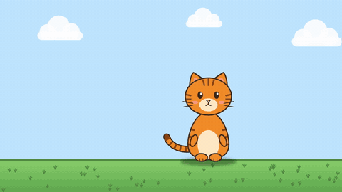
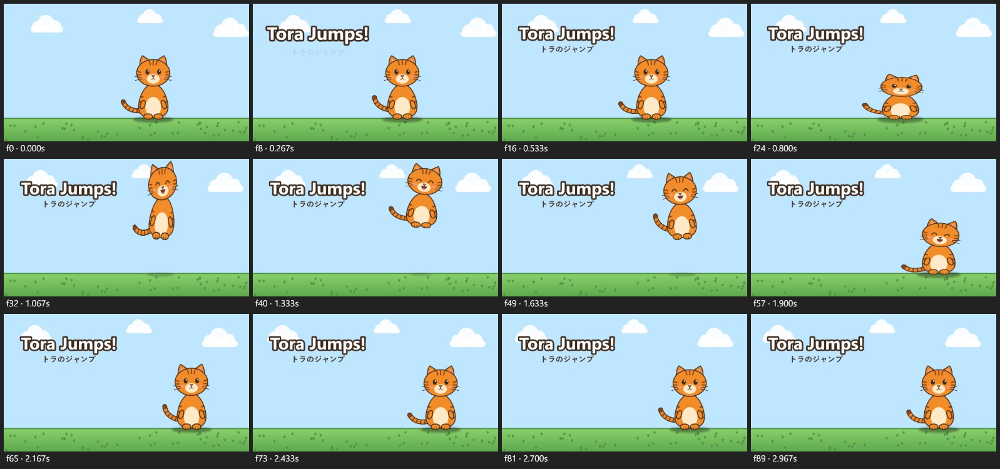
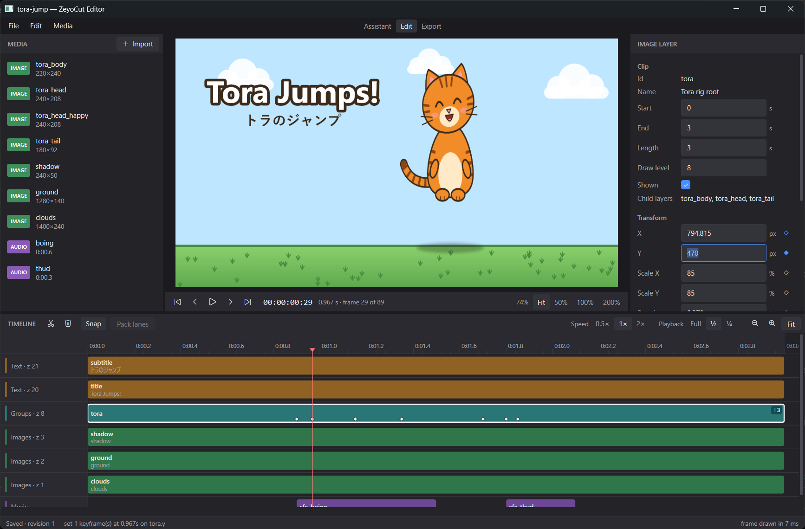

# ZeyoCut

**A video and animation editor that an AI model drives.** ZeyoCut is an [MCP](https://modelcontextprotocol.io) server for Windows. You tell Claude, or another MCP client, what you want. The model builds the project through ZeyoCut's tools, looks at rendered frames to check its work, and exports the MP4. A window for fine-tuning the same project by hand, [the editor](#the-editor), opens it while the model keeps working on it.

[Website](https://cut.zeyoapp.com) · [Install](docs/install.md) · [Guide](docs/GUIDE.md) · [Tool reference](docs/TOOLS.md) · [Examples](examples/README.md)



*The built-in demo (`ZeyoCut.Mcp.exe demo`): a rigged cat with squash and stretch, a drawing swap and a Japanese subtitle, all drawn by code.*

## What it does

- **Cutout animation with rigs and actions.** Characters made of PNG parts in a parent–child hierarchy, with keyframes and easing (overshoot, bounce, elastic), squash and stretch, drawing swaps such as a face changing expression, and motion along curved paths. Save a character as a rig and a walk cycle or a jump as an action: the action plays on any copy of the rig, at any speed.
- **Comic-panel videos.** Pan and zoom over still images, timed to a voiceover, with music and subtitles.
- **Footage editing.** Analysis finds scene cuts, silences and a transcript with a time for every word. Cut silences and filler words with ripple, join clips with transitions, burn in captions or export SRT, duck music under voice, normalize loudness to -14 LUFS, and export for YouTube and as a vertical Short from one call.
- **Burmese, Japanese and other languages.** Text is shaped with HarfBuzz, so Burmese stacking and Japanese line breaking come out right. One project can hold a version per language, each with its own titles, voice and captions, and one call exports them all.
- **Privacy blur.** An AI model on your computer finds every face or license plate in a clip. Each one is tracked and hidden (pixelate, blur or solid) with a fail-safe that leaves no frame uncovered, through cuts and speed changes, and a report lists the spans to check before you export. Nobody is recognized and no plate is read.
- **Cutouts.** Backgrounds come off green-screen footage, generated art and ordinary footage of people, and titles can go behind the person.
- **Tracking.** Follow a face or an object through a clip, and pin a name or a sticker to it.
- **Checks before export** find single-frame glitches, loudness problems and project mistakes such as missing files or text under the Shorts player UI.
- **Hand-off.** The timeline exports as OpenTimelineIO or FCPXML, to finish in DaVinci Resolve or Final Cut Pro.
- **A library** shared by all projects keeps rigs, actions, text styles, project templates and your sound effects.

Previews and exports go through the same renderer, so the frame the model checks is exactly the frame that gets encoded. Rendering is deterministic, and a preview page in the browser plays the edit with its sound and follows every change.



*A contact sheet: the model looks at frames like these to check its work.*

## Quick start

1. Install FFmpeg: `winget install Gyan.FFmpeg`.
2. Download the latest [release](https://github.com/zeyarwinthu/zeyocut/releases) and check its SHA-256.
3. Connect it:
   - **Claude Desktop:** Settings → Extensions → Advanced settings → Install Extension…, and choose `ZeyoCut-<version>.mcpb`.
   - **Claude Code:** unzip `ZeyoCut-<version>-win-x64.zip`, for example to `C:\Tools\ZeyoCut`, and run `claude mcp add --transport stdio --scope user zeyocut -- C:\Tools\ZeyoCut\ZeyoCut.Mcp.exe`.
   - **Other MCP clients:** run `ZeyoCut.Mcp.exe` as a local (stdio) server.

[docs/install.md](docs/install.md) has every step, including what to do about Windows' warnings for an exe that isn't code-signed yet.

Then ask for something. ZeyoCut imports files from your Desktop, Documents, Downloads, Music, Pictures and Videos folders unless you [add others](#configuration).

> Run ZeyoCut's system check.

> Create a ZeyoCut project "tora-test", 1280x720, 3 seconds. Import body.png, head.png and tail.png from my Pictures\tora folder. Parent the head at the neck and the tail at the back, make the character jump with squash before takeoff, stretch in the air and an easeOutBack landing, then show me a contact sheet with debug on.

> Make a 12-second comic video from the panels in my Pictures\comic folder: slow zoom into each panel, cross-fade between them, add voice.mp3 from the same folder, and Burmese subtitles in a dark box at the bottom. Export it as comic.mp4.

> Make a YouTube video from Videos\talk.mp4: cut the silences with punch-ins, remove the "um"s, add bold captions and Music\bed.mp3 under the voice, and export it with the youtube_1080p preset. Then make a vertical Short of it with the speaker centered.

> Blur every face in Videos\street.mp4, show me the frames I should check, and export it.

## The editor

`ZeyoCut.Editor.exe`, next to `ZeyoCut.Mcp.exe` in the release zip, opens the same projects in a window, for working on them by hand. It imports media, plays the edit with its sound, edits clips on a timeline and in an inspector, places them in the picture, sets their effects and keyframes, times and eases keyframes on a dope sheet or as curves, puts transitions on cuts, adds titles in saved styles and templates, and exports. Masks and motion paths are still the model's; ask it for those. The [editor guide](docs/editor.md) shows it with screenshots.



- **Open a project** from Home, which shows your recent projects and the rest of your projects folder as cards with a picture of each and a search box, with New project… (Ctrl+N, a name, a canvas, a frame rate and a background, or a library template) or Open folder… (Ctrl+O), from the command line (`ZeyoCut.Editor.exe C:\Users\you\ZeyoCut\projects\my-video`), or by asking the model to open it in the editor (`open_in_editor`). A project is open in one window at a time: opening it again brings that window to the front. Files that moved are found again in the Relink view, as `relink_asset` does, and the first start shows how to connect Claude and opens a sample.
- **Six views:** Edit, Audio, Animate, Captions and Activity, switched in the header, and Export, opened by the header's Export button (or Ctrl+1, Ctrl+2, Ctrl+3, Ctrl+5, Ctrl+6 and Ctrl+E: Edit, Audio, Animate, Captions, Activity and Export; ? or F1 lists every key). The header names the project, shows whether it's saved, undoes and redoes, and says when Claude last saved; the logo goes back to the projects.
- **Import** images, audio, fonts and video with Import above the media list (Ctrl+I). Video that needs normalizing (variable frame rate, rotation, HDR) is converted first, as `import_video` does, with its progress in the media list. Files you pick yourself can come from any folder; the import folders limit only what the model can read.
- **Drag files** from File Explorer onto the window to import them. A project folder dropped on Home opens.
- **Put media on the timeline** by dragging it from the media list onto a lane, or right-click it → Add at the playhead. A video or picture dropped on a picture lane is drawn at that lane's level, and anywhere else on a level of its own on top. Sound takes the role of the sound lane it's dropped on, else music.
- **The Media browser**, from the media panel's rail, shows the media as cards with their sizes, lengths and uses, by kind or in bins (the files' tags, as `tag_assets` sets them), with a search, the selected files' details and tags, Relink for missing files, and Add at playhead.
- **Titles**, on the rail, shows the library's text styles and templates drawn by the renderer. It adds a title with two lines, colors and a way in and out (Fade, Pop, Slide up) at the playhead, as `add_text_layer` does, edits the selected title the same way, applies a style or saves a title's look over one, and adds a template's layers from the playhead, as `add_template` does.
- **Effects**, on the rail, puts a transition (Crossfade, Dip to black, Wipe, Slide, Zoom or Whip pan, with its duration and direction) on the cut clicked on the timeline, or on every cut of a lane as one step, as `add_transition` does; it also adds the inspector's video effects and the text animations to the selected layer.
- **Color**, on the rail, grades a video or picture as `set_color` does: exposure, contrast, highlights, shadows, temperature, tint and saturation, with the clip as shot beside it (After, Split, Before), a waveform and a vectorscope of the frame, Reset all, Copy and Paste grade, and Apply to all clips of the same footage.
- **The source viewer** (double-click a video or a sound) plays a file on its own beside the program. Mark in (I) and Mark out (O) choose the part to use, which Insert (,) or Overwrite (.) puts at the playhead on the lane you choose, as the add-layer tools' `edit` does; for footage, Audio says whether its sound comes along.
- **The preview** draws the frame at the playhead with the same renderer as exports, from proxies for footage over 2560 px. Step with ←/→ (Shift: a second at a time), Home and End. Fit, 50%, 100% and 200% set the zoom. A safe-area guide (as `check_project` checks it) and a thirds grid can be drawn over the frame, and F shows it on the whole screen. When layers are tagged with languages, it draws one language's version, chosen in its header, as an export in that language does.
    - Click a video, picture or text in the preview to select it: the one drawn on top there, a layer attached to a clip (a logo on a video, a part of a rig) too. Its box and anchor are outlined, and the timeline highlights the clip that holds it.
    - Drag it to move it. The frame is redrawn as you drag, and the move is saved when you let go, as one undo step. Shift keeps it on one axis, and Escape puts it back. An animated position gets a keyframe at the playhead, as in the inspector. A caption takes its whole track along. A layer on a motion path doesn't move: the path places it.
- **Playback.** Space plays and pauses, at 0.5×, 1× or 2×, with the sound mixed as the export mixes it. After an edit that changes the sound, the mix is made again in the background; until it's ready, playback is silent and says "updating sound…". While playing, frames are drawn at half size (Preview: Full, ½ or ¼ res), and when drawing can't keep up, every second frame is shown. A paused frame is always full size. Loop plays on from the start at the end.
- **The media panel** shows a tile for each asset, with a thumbnail of pictures and footage and a waveform of sound, and chips that show one kind.
- **The timeline** has a lane for each draw level (`zIndex`) of video, images and text, the highest on top, named for what it holds (Video 2 draws over Video 1); a lane for each caption track; and Voice, Music and Sound effects lanes for sound. A layer with child layers (a logo attached to a clip, a rig) is one clip with a "+N" badge, and its children move, trim, split and delete with it. Click a clip to select it and see it in the inspector.
    - A lane's eye hides every clip in it (mutes, on a sound lane) as one step. The Blade (B) splits a clip where it's clicked, and Add marker (M) puts a chapter marker at the playhead.
    - Drag a clip sideways to move it, or drag its edges to trim it; a video can show more as far as its source goes. Drag a video, picture or text clip up or down onto another lane to change what it's drawn over, or between two lanes to give it a level of its own. Escape cancels the drag.
    - Held at the left or right edge of the lanes, a drag scrolls them, faster the further in. Scrubbing in the ruler does the same.
    - Clips snap to clip edges, the playhead and markers. The Snap button (N) turns it off.
    - S (or Ctrl+B) splits the selected clip at the playhead, and Delete removes it with its child layers (a child layer selected in the preview is removed with its own children). Right-click a clip for these, for Hide and Show (Mute and Unmute for sound), and to turn a video's own sound off or on. Ctrl+D duplicates the selected clip with its child layers.
    - Click or drag in the ruler to move the playhead; ↑ and ↓ jump to the previous and next clip edge.
    - The selected clip shows its layer's keyframes as white diamonds along its bottom edge. Click one to move the playhead there; Alt+← and Alt+→ jump to the previous and next.
    - Ctrl+wheel, −/+ or the zoom slider zooms and Fit (Shift+Z) fits the whole video. The wheel scrolls the lanes and Shift+wheel scrolls in time.
    - **Pack lanes** puts layers that never show at the same time on shared levels, so clips the model added one at a time stop taking a lane each. Every frame looks as before. When it can't save a lane, the button is off.
- **The inspector** shows the selected clip and changes it, on tabs by kind (a video's Video, Audio, Speed, Effects and Color). Its header says where the clip comes from and what goes with it, and its ⋯ menu splits, deletes, hides or mutes it. Start, End and Length move and trim it; Draw level is its `zIndex`; Shown hides it (Muted for sound). Chips list the layers attached to it, and a child's chip selects it. A video's speed is set as `set_speed` sets it, without moving the clips after it. A video has Sound on, and sound has its role, volume and fades. A text has its text and its style: font (an installed family, or a font file imported into the project), size, bold, color, outline, alignment, maximum width, line height and a box behind it. A caption's text is its own, and its style is the whole track's: a change applies to every caption in the track, as one undo step.
    - **Transform:** Position X and Y place the layer's anchor on the canvas (a child layer's, in its parent's pixels), Scale W and H size it in percent (negative flips it), Rotation turns it in degrees around the anchor, and Opacity is in percent, with a slider that saves when it's let go. A value animated with keyframes shows its value at the playhead; changing it adds a keyframe there (or changes the one on that frame), with the easing of the keyframe before it, so the move keeps its feel. That needs the playhead where the layer is. A layer that follows a motion path shows Position: the path places it; ask the model to change the path. A caption's X and Y move every caption in its track by the same amount.
    - **Keyframes:** the diamond beside a number animates it. ◇ adds a keyframe at the playhead with the value shown; ◆ means there's one at the playhead, and takes it away. Position's and Scale's diamond keys both values. Blue means the value is animated. Taking away the last keyframe leaves the value it had there. Pressed while playing, it stops the playback and keys that frame; clicking into an animated value while playing stops it too. Blurring seconds 2 to 4, say: at 2 s switch Blur on, set it to 0 and press ◇; at 2.5 s type 8; at 3.5 s press ◇; at 4 s type 0.
    - **Crop:** a video's Left, Top, Right and Bottom cut that many pixels of its file off each side. What's left of the picture stays where it was, and so do child layers on it. A crop the model animated is changed with keyframes; ask the model.
    - **Face blur:** a video whose footage a redaction hides (`apply_redaction`) shows its settings: Style, Strength (pixelate and blur) or Fill color (solid), Padding, Feather and Hold frames, a section for each redaction. They are the redaction's, so they change every clip of that footage.
    - **Effects:** Blur, Shadow, Border (the outline effect) and Tint switch an effect on and off, as `set_effect` does. Switched on, each shows its settings: the blur's size each way; the shadow's color, offset, softness and opacity; the border's color and width; the tint's color and amount (a new tint is white). Captions don't have them.
    - **Adjustments:** a video's or picture's Brightness, Contrast and Saturation, in percent: 0, 100 and 100 leave it as it is.
    - Enter saves a field, and so does clicking or tabbing away; Escape puts it back. In a text, Shift+Enter starts a new line.
    - Numbers take a point or a comma, with or without their unit: `2,5`, `2.5 s`, `40px`, `50%` and `15°` all work. A value the project can't take is refused with the reason, and the field shows what's saved.
- **The Audio view** (Ctrl+2) mixes the sound: a strip for each sound role (Voice, Music and Sound effects) with a fader, pan, mute and solo, and Master with a meter while playing. The level, pan and mute are saved in the project as `update_project` saves them, and exports and the preview mix them; solo is the preview's only. The loudness target, a Measure button that measures the mix as `audio_levels` does, the music's ducking (on or off, how deep, how fast), and a lane per role where points on each clip's volume line are its `volume` keyframes, with the ducked stretches shaded.
- **The Animate view** (Ctrl+3) lists the animated layers and values with their values at the playhead, and shows their keyframes as a dope sheet or as curves. Dragging keys retimes them by whole frames, keeping their values and easings, and in the graph changes their values too; each drag is one undo step. The eight easings and a custom cubic bezier (as `set_keyframes` takes it) are set on the selected keys. Over the frame, the onion skin draws the selected layer at the frames around the playhead, and the motion path where it goes.
- **The Captions view** (Ctrl+5) shows every caption track side by side, a row for each caption with its translations, for typing in. A row's start and end move it in every language as one undo step. Add caption at playhead, Import .srt… (as `import_srt` reads it) and Save .srt files (to `exports`, as `export_srt` writes them), and one style for all captions: each track's font, and size, position, background and line width for every track. New languages are the model's (`add_caption_track`).
- **Export** (Ctrl+E) renders the project as it's saved to an MP4 in its `exports` folder, as the model's `start_export` does, in the editor's own process: the project's settings or a preset of the same shape (each a card with its size and frame rate), one language's version when layers are tagged with languages, and a quality (High, Balanced or Small: `start_export`'s crf 18, 23 or 28). It can also save caption tracks as .srt files next to the video, as `export_srt` writes them. A card shows a picture of the project and what the export will be; the export running here shows its progress and Stop, and Claude's running exports of the project show their progress. Each file in the `exports` folder can be played in the default player or shown in its folder. Replacing a file asks first, and closing the window or the project while an export runs asks whether to stop it.
- **The Activity view** (Ctrl+6) lists the saves the backups folder keeps, yours and Claude's, grouped into steps under their days, with a filter for whose to show. Restore puts the project back as a step left it, as a new revision that Ctrl+Z takes back, the way the model's `restore_backup` does. A card beside them suggests what to ask the model.
- **Every change is saved at once**, as one step that Ctrl+Z undoes and Ctrl+Shift+Z (or Ctrl+Y) redoes. The header shows "Saved · rev N"; there's no Save button.
- **With Claude at the same time.** When the server saves the project, the editor shows the new version and says what changed. The server's next reply lists what the editor changed. See [Saving alongside another program](docs/project-format.md#saving-alongside-another-program).

The editor reads `FfmpegPath`, `ProjectsRoot`, `LibraryPath` and `VideoEncoder` from the same `appsettings.json` and environment variables as the server. It keeps its own settings (recent projects, cards or list on Home, panel sizes, window position, snapping, playback size, preview language) in `%LOCALAPPDATA%\ZeyoCut\editor.json`, or the file `ZEYOCUT_EDITOR_SETTINGS` names, never in the project.

## Privacy

ZeyoCut has no telemetry and no account. Your projects and media stay on your computer. It goes online for one thing only: downloading an AI model from its original source the first time a feature needs it, checked against a pinned SHA-256. The preview page answers only on `127.0.0.1`, and ONNX Runtime's own telemetry is turned off. To run models on a GPU, ZeyoCut uses Microsoft's DirectML, which may send diagnostic information to Microsoft as your Windows diagnostic data settings allow; `AiDevice` `cpu` keeps every model on the CPU. The [privacy page](docs/privacy.md) has the details.

What you make with ZeyoCut is yours. The MIT license covers ZeyoCut's code, not your videos.

## Documentation

| | |
|---|---|
| [Install](docs/install.md) | Download, check, connect a client, first run, folders, uninstall |
| [Guide](docs/GUIDE.md) | Every tool, with an example call and the real response |
| [Tool reference](docs/TOOLS.md) | Every tool and its parameters, generated from the server |
| [Project format](docs/project-format.md) | The project folder and `project.json`, and how animation, text, video and audio work |
| [Architecture](docs/architecture.md) | How the code is organized; rendering, export and the command line |
| [Examples](examples/README.md) | Projects to open, with the prompts that made them, and the steps for cleaning up a talking-head video |

## Requirements

| What | Why |
|---|---|
| Windows 10/11 x64 | Target platform |
| [.NET 10 SDK](https://dotnet.microsoft.com/download/dotnet/10.0) | To build and test. The published single exe doesn't need it. |
| FFmpeg (`ffmpeg.exe` + `ffprobe.exe`) | Exporting MP4, reading audio durations when you import audio, and everything to do with video (import, decoding, analysis) |
| whisper.cpp `whisper-cli` + a ggml model (optional) | Transcripts for `analyze_video`, which `cut_by_transcript` and `generate_captions` need. Without it, analysis still finds scene cuts and silences. |
| Fonts *Myanmar Text* and *Yu Gothic* | Burmese and Japanese text. Both ship with Windows 10/11. Any other font can be imported as a `.ttf`/`.otf` asset. |

[docs/install.md](docs/install.md) shows how to install FFmpeg and whisper.

## Configuration

`appsettings.json` sits next to the exe. Empty values mean "use the default".

```json
{
  "ZeyoCut": {
    "FfmpegPath": "", "ProjectsRoot": "", "LogDirectory": "", "JobsDirectory": "", "WhisperPath": "", "WhisperModel": "", "LibraryPath": "", "ModelsPath": "", "AiDevice": "", "VideoEncoder": "", "EditorPath": "",
    "ClipDescriber": { "Provider": "", "ApiKeyVariable": "" },
    "LanguageFonts": { "my": "Myanmar Text", "ja": "Yu Gothic" }
  },
  "Logging": { "LogLevel": { "Default": "Information", "Microsoft": "Warning", "ModelContextProtocol": "Warning" } }
}
```

| Setting | Environment variable (wins) | Default |
|---|---|---|
| `FfmpegPath` | `FFMPEG_PATH` | search `PATH` |
| `ProjectsRoot` | `ZEYOCUT_PROJECTS_DIR` | `%USERPROFILE%\ZeyoCut\projects` |
| `ImportFolders` | `ZEYOCUT_IMPORT_DIRS` (folders separated by `;`) | your Desktop, Documents, Downloads, Music, Pictures and Videos: where tools may import files from, besides the projects folder and the library. A path anywhere else, also through a link or junction, gets an error naming this setting. Projects must be inside `ProjectsRoot` |
| `LogDirectory` | `ZEYOCUT_LOG_DIR` | `%LOCALAPPDATA%\ZeyoCut\logs` |
| `JobsDirectory` | `ZEYOCUT_JOBS_DIR` | `%LOCALAPPDATA%\ZeyoCut\jobs`: a record of every background job, kept for 7 days, so jobs outlast a restart. An export that was running starts again, and any other job shows why it stopped (see [the guide](docs/GUIDE.md#get_job_status)) |
| `WhisperPath` | `WHISPER_PATH` | search `PATH` for `whisper-cli` |
| `WhisperModel` | `WHISPER_MODEL` | `ggml-small.bin` (or any `ggml-*.bin`) near `whisper-cli` |
| `LibraryPath` | `ZEYOCUT_LIBRARY_DIR` | `%USERPROFILE%\ZeyoCut\library` |
| `ModelsPath` | `ZEYOCUT_MODELS_DIR` | `models` in the library folder: the AI models for background removal and for face and plate detection, downloaded on first use (see [AI models](#ai-models)) |
| `AiDevice` | `ZEYOCUT_AI_DEVICE` | `auto`: a model runs on DirectML only where the `system_check` tool measured that it works and takes at most 80% of the CPU's time, otherwise on the CPU (also before `system_check` has run). `cpu` always uses the CPU; `gpu` uses DirectML and falls back to the CPU when DirectML can't start. On an Intel Arc 140T, DirectML was no faster for the video model, took twice as long for face detection, hung or failed on the image model and hung on the plate model, so `auto` uses the CPU for all four |
| `VideoEncoder` | `ZEYOCUT_VIDEO_ENCODER` | `auto`: the first GPU encoder that works (NVIDIA NVENC, Intel Quick Sync, AMD AMF, tried in that order once per computer and FFmpeg, results in the library's `encoders.json`), else libx264. `x264`, `nvenc`, `qsv` or `amf` names one; a GPU encoder that doesn't work falls back to libx264. Lossless exports (`crf` 0) always use libx264 |
| `EditorPath` | `ZEYOCUT_EDITOR_PATH` | `ZeyoCut.Editor.exe` next to `ZeyoCut.Mcp.exe`: the editor `open_in_editor` starts |
| `ClipDescriber:Provider` | `ZEYOCUT_DESCRIBER_PROVIDER` | none, so `describe_clip` is off |
| `ClipDescriber:ApiKeyVariable` | | `ZEYOCUT_DESCRIBER_API_KEY`: the name of the environment variable that holds the describer's API key |
| `LanguageFonts` | | `my`: Myanmar Text, `ja`: Yu Gothic. The font a text in a language gets when it is given none, by language tag. Entries here add languages or change these two; a tag with no entry uses a shorter tag's (`zh-Hant-TW`, then `zh-Hant`, then `zh`) |

**`describe_clip`** is an optional tool that sends a short stretch of video to an outside video-understanding service and returns what happens, with times. No describer is built in yet (Gemini is planned), so the tool doesn't appear. Once one exists, set its provider name and put its API key in the environment variable above; the key is never stored in a file. The server log says on each start whether the tool is on, or why not. See [the guide](docs/GUIDE.md#optional-describe_clip).

### How FFmpeg and whisper are found

ZeyoCut looks for FFmpeg in this order:
1. `ZeyoCut:FfmpegPath` in `appsettings.json`
2. the `FFMPEG_PATH` environment variable (a file, or a folder; its `bin` subfolder is checked too)
3. `PATH`

`ffprobe.exe` is taken from the same folder as `ffmpeg.exe`, or else from `PATH`. If nothing is found, the export tools reply with install instructions. Editing and previewing work without FFmpeg.

ZeyoCut looks for `whisper-cli.exe` in this order:
1. `ZeyoCut:WhisperPath` in `appsettings.json`
2. the `WHISPER_PATH` environment variable (the exe or a folder, including its `bin\Release` subfolder)
3. `PATH`

The model is `WhisperModel` / `WHISPER_MODEL` if set. Otherwise it is `ggml-small.bin`, or any `ggml-*.bin`, found next to the exe or in a `models` folder up to three levels above it. A 15-second clip transcribes in about 4 seconds on a modern CPU.

### AI models

No model is shipped with ZeyoCut. Each is downloaded into `ModelsPath` the first time a feature needs it, and checked against its pinned SHA-256. Everything else works without them.

| Model | Used for | Size | License |
|---|---|---|---|
| [Robust Video Matting](https://github.com/PeterL1n/RobustVideoMatting) (MobileNetV3) | `remove_background` `aiVideo` | 15 MB | GPL-3.0, so it stays a separate download |
| [BiRefNet lite](https://huggingface.co/onnx-community/BiRefNet_lite-ONNX) | `remove_background` `aiImage` | 224 MB | MIT |
| [YuNet](https://github.com/opencv/opencv_zoo/tree/main/models/face_detection_yunet) (OpenCV Zoo, 2026may) | `detect_and_track` faces | 230 KB | MIT |
| [open-image-models](https://github.com/ankandrew/open-image-models) YOLOv9-t, 640 px | `detect_and_track` plates | 8 MB | The repository is MIT, but it doesn't state a license or the training data for the weights it releases, and the original YOLOv9 code is GPL-3.0. Check this before relying on plate detection in a product |

Tracking uses OpenCV 4.13 through OpenCvSharp4, both Apache-2.0, which are built into the exe.

**Logging.** The server writes protocol messages, and only protocol messages, to stdout. Logs go to:
- stderr, which Claude desktop saves to `%APPDATA%\Claude\logs\mcp-server-zeyocut.log`
- a daily file, `zeyocut-yyyyMMdd.jsonl`, in the log directory, with one JSON object per line. Every tool call is logged with its arguments, how long it took and, if it failed, its error. The `get_logs` tool reads it (see [the guide](docs/GUIDE.md#get_logs))
- `connected.json` in the log directory, the name of the last client that listed the tools and when. The editor's Welcome reads it to tell that Claude is connected

## Build and test

```powershell
dotnet build
dotnet test
```

- `global.json` selects the Microsoft.Testing.Platform runner. xUnit v3 needs it under the .NET 10 SDK.
- Tests that need FFmpeg are reported as **skipped** when it isn't installed. The same goes for the transcript tests without whisper (they find it through `WHISPER_PATH` or `PATH`) or Windows text-to-speech, which they use to make spoken test audio.
- Test media (tones, test patterns, speech) is generated at test time. The only media files in the repository are three public-domain photos for the face and plate detection tests; [their README](tests/ZeyoCut.Tests/Fixtures/README.md) names their sources.
- To run one test class, use the test exe directly:
  ```powershell
  tests\ZeyoCut.Tests\bin\Debug\net10.0\ZeyoCut.Tests.exe -class "ZeyoCut.Tests.Demo.DemoTests"
  ```
- The text-shaping tests save their PNGs (Burmese "မင်္ဂလာပါ" in Myanmar Text, Japanese "こんにちは" in Yu Gothic, wrapped subtitles) to `tests\ZeyoCut.Tests\bin\Debug\net10.0\TestOutput\text-shaping\`.
- [CONTRIBUTING.md](CONTRIBUTING.md) covers the code style, adding a tool and the DCO sign-off.

### Publish a single exe

```powershell
dotnet publish src/ZeyoCut.Mcp -c Release -r win-x64 --self-contained -p:PublishSingleFile=true -p:IncludeNativeLibrariesForSelfExtract=true
```

The output goes to `src\ZeyoCut.Mcp\bin\Release\net10.0\win-x64\publish\`:
- `ZeyoCut.Mcp.exe` (about 180 MB): the .NET runtime, SkiaSharp, HarfBuzz, ONNX Runtime and OpenCV in one file. OpenCV's own FFmpeg video module is left out, since ZeyoCut decodes video with the FFmpeg you install.
- `appsettings.json`: optional settings, see [Configuration](#configuration).

Copy both anywhere, for example `C:\Tools\ZeyoCut\`. On first run the native libraries extract to `%TEMP%\.net\ZeyoCut.Mcp\`.

To try your own build, point the MCP client at `src\ZeyoCut.Mcp\bin\Debug\net10.0\ZeyoCut.Mcp.exe`. Don't use `dotnet run` as the command: its build output goes to stdout and corrupts the protocol stream.

The editor publishes the same way:

```powershell
dotnet publish src/ZeyoCut.Editor -c Release -r win-x64 --self-contained -p:PublishSingleFile=true -p:IncludeNativeLibrariesForSelfExtract=true
```

Its `ZeyoCut.Editor.exe` (about 150 MB) goes to `src\ZeyoCut.Editor\bin\Release\net10.0-windows\win-x64\publish\`. It leaves out OpenCV, ONNX Runtime and DirectML, since the editor runs no AI models. Copy it next to `ZeyoCut.Mcp.exe`, so that both read the same `appsettings.json`. `dotnet test` runs the editor's tests with the others; to run them alone, use `tests\ZeyoCut.Editor.Tests\bin\Debug\net10.0-windows\ZeyoCut.Editor.Tests.exe`.

## FAQ

**Do I need Claude?** No. Any MCP client that can run a local (stdio) server works, such as Claude Desktop, Claude Code or VS Code. Use a model that can look at images: `render_frame` and `render_contact_sheet` return pictures, and that's how the model checks its work.

**Is there an editing window?** Yes: [the editor](#the-editor) opens the project the model is working on, for trimming and moving clips, placing and cropping things in the picture, fixing captions, mixing the sound and exporting by hand. Ask the model to open it, or start `ZeyoCut.Editor.exe`. Everything else the model edits through ZeyoCut's tools. You also see the result as frames and contact sheets in the chat, and on a preview page in your browser (`preview_server`) that plays the edit with its sound and follows every change. Every change can be undone.

**Can I edit while Claude works?** Yes. The editor saves each change as you make it. The model's next tool call starts with a note of what you changed and builds on it, and what the model changes shows in the editor within a second. Undo on either side takes back only its own changes.

**Does it cost anything?** ZeyoCut is free and needs no account. Your MCP client and its AI model may have their own costs.

**Are my videos uploaded?** ZeyoCut uploads nothing: editing, rendering, export and the AI models all run on your computer. Your MCP client does send ZeyoCut's replies to its AI model, and those can include transcripts, file names and the frames the model looks at. See [Privacy](#privacy).

**Do I need a GPU?** No. Everything runs on the CPU. Where a GPU helps, ZeyoCut uses it: a GPU video encoder for exports when one works, and DirectML for an AI model where `system_check` measured that it's faster.

**Does it run on macOS or Linux?** No. ZeyoCut is built and tested for Windows 10 and 11 (x64) only.

**Why does Windows warn me about the exe?** It isn't code-signed yet. Check its SHA-256 against the release's `SHA256SUMS.txt`; [docs/install.md](docs/install.md#windows-warnings) shows how, and what to do about SmartScreen.

**Why can't it open a file on my D: drive?** ZeyoCut reads files only from the projects folder, the library and the import folders: your Desktop, Documents, Downloads, Music, Pictures and Videos, unless you change them. Add the folder to `ImportFolders` or `ZEYOCUT_IMPORT_DIRS` (see [Configuration](#configuration)).

**Which languages can it write?** Any language your fonts cover. Text is shaped with HarfBuzz; Burmese and Japanese get Myanmar Text and Yu Gothic, and `LanguageFonts` sets the font for others. Transcripts and captions come from whisper, in the languages it knows.

**Can I finish an edit in another editor?** Yes. `export_otio` and `export_fcpxml` hand the timeline to DaVinci Resolve or Final Cut Pro.

## Limitations

- Undo history lives in memory for the current server session (200 steps). After another program saves the project, undo takes back only what each step changed, and is refused where that program changed the same items. `project.json` itself always holds the latest state, and `backups\` the 20 before it.
- One project is open at a time.
- The preview page plays frames of up to 640 px, about 15 a second, drawn when first shown, so a part's first play can stutter. `render_frame` shows the full size.
- The finished video is MP4 (H.264 + AAC) only. Other editors get the timeline instead, from `export_otio` and `export_fcpxml`.
- **Whisper's word times are approximate.** Whisper sometimes places the words next to a long pause inside it. `analyze_video` fits the words to the silences it measures, so such words move back onto the speech they belong to. Within a stretch of speech, times can still be off by a few tenths of a second. Check cuts with `render_frame` or `view_source`, and read the transcript before cutting by words.
- Captions don't follow cuts made after `generate_captions`; run it again to replace them.

## Roadmap

- **PSD import and a rig builder:** turn a layered PSD into a rig, with its parts, pivots and drawings.
- **A clip describer** for `describe_clip`, starting with Gemini.

## Contributing

Contributions are welcome: see [CONTRIBUTING.md](CONTRIBUTING.md). Every commit needs a DCO sign-off (`git commit -s`). Everyone taking part follows the [Code of Conduct](CODE_OF_CONDUCT.md). Please report security problems privately, as [SECURITY.md](SECURITY.md) describes.

## License

ZeyoCut is released under the [MIT License](LICENSE), Copyright (c) 2026 Zeyo. The libraries it includes and their licenses are listed in [THIRD_PARTY_NOTICES.md](THIRD_PARTY_NOTICES.md). The AI models aren't part of ZeyoCut: each is downloaded from its source and has its own license (see [AI models](#ai-models)).
