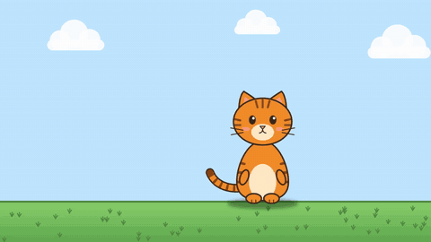
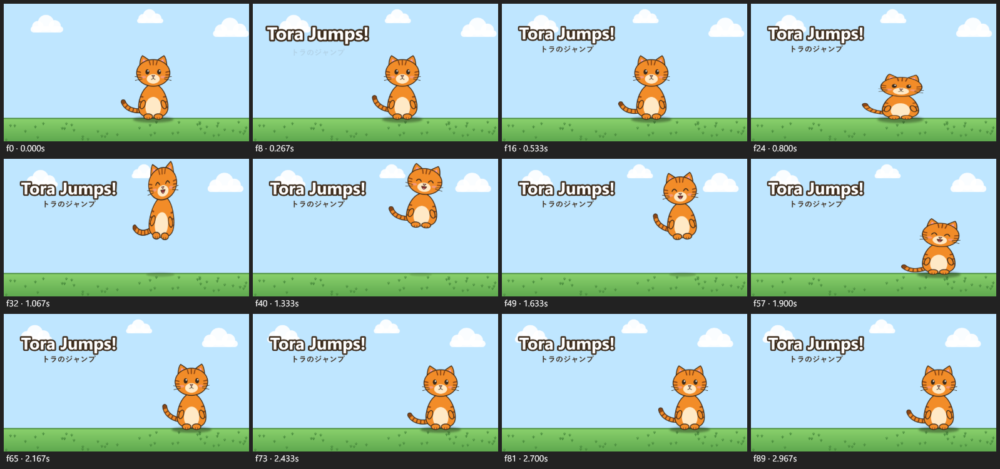

# ZeyoCut

**A video and animation editor that an AI model drives.** ZeyoCut has no window of its own: it is an [MCP](https://modelcontextprotocol.io) server for Windows. You tell Claude, or another MCP client, what you want. The model builds the project through ZeyoCut's tools, looks at rendered frames to check its work, and exports the MP4.

[Website](https://cut.zeyoapp.com) · [Install](docs/install.md) · [Guide](docs/GUIDE.md) · [Tool reference](docs/TOOLS.md) · [Examples](examples/README.md)



*The built-in demo (`ZeyoCut.Mcp.exe demo`): a rigged cat with squash and stretch, a drawing swap and a Japanese subtitle, all drawn by code.*

## What it does

- **Cutout animation with rigs and actions.** Characters made of PNG parts in a parent–child hierarchy, with keyframes and easing (overshoot, bounce, elastic), squash and stretch, drawing swaps such as a face changing expression, and motion along curved paths. Save a character as a rig and a walk cycle or a jump as an action: the action plays on any copy of the rig, at any speed.
- **Comic-panel videos.** Pan and zoom over still images, timed to a voiceover, with music and subtitles.
- **Footage editing.** Analysis finds scene cuts, silences and a transcript with a time for every word. Cut silences and filler words with ripple, join clips with transitions, burn in captions or export SRT, duck music under voice, normalize loudness to -14 LUFS, and export for YouTube and as a vertical Short from one call.
- **Burmese, Japanese and other languages.** Text is shaped with HarfBuzz, so Burmese stacking and Japanese line breaking come out right. One project can hold a version per language, each with its own titles, voice and captions, and one call exports them all.
- **Privacy blur.** An AI model on your computer finds every face or license plate in a clip. Each one is tracked and hidden (pixelate, blur or solid) with a fail-safe that leaves no frame uncovered, through cuts and speed changes, and a report lists the spans to check before you export. Nobody is recognized and no plate is read.
- **Cutouts.** Backgrounds come off green-screen footage, generated art and ordinary footage of people, and titles can go behind the person.
- **Tracking.** Follow a face or an object through a clip, and pin a name or a sticker to it.
- **Checks before export** find single-frame glitches, loudness problems and project mistakes such as missing files or text under the Shorts player UI.
- **Hand-off.** The timeline exports as OpenTimelineIO or FCPXML, to finish in DaVinci Resolve or Final Cut Pro.
- **A library** shared by all projects keeps rigs, actions, text styles, project templates and your sound effects.

Previews and exports go through the same renderer, so the frame the model checks is exactly the frame that gets encoded. Rendering is deterministic, and a preview page in the browser plays the edit with its sound and follows every change.



*A contact sheet: the model looks at frames like these to check its work.*

## Quick start

1. Install FFmpeg: `winget install Gyan.FFmpeg`.
2. Download the latest [release](https://github.com/zeyarwinthu/zeyocut/releases) and check its SHA-256.
3. Connect it:
   - **Claude Desktop:** Settings → Extensions → Advanced settings → Install Extension…, and choose `ZeyoCut-<version>.mcpb`.
   - **Claude Code:** unzip `ZeyoCut-<version>-win-x64.zip`, for example to `C:\Tools\ZeyoCut`, and run `claude mcp add --transport stdio --scope user zeyocut -- C:\Tools\ZeyoCut\ZeyoCut.Mcp.exe`.
   - **Other MCP clients:** run `ZeyoCut.Mcp.exe` as a local (stdio) server.

[docs/install.md](docs/install.md) has every step, including what to do about Windows' warnings for an exe that isn't code-signed yet.

Then ask for something. ZeyoCut imports files from your Desktop, Documents, Downloads, Music, Pictures and Videos folders unless you [add others](#configuration).

> Run ZeyoCut's system check.

> Create a ZeyoCut project "tora-test", 1280x720, 3 seconds. Import body.png, head.png and tail.png from my Pictures\tora folder. Parent the head at the neck and the tail at the back, make the character jump with squash before takeoff, stretch in the air and an easeOutBack landing, then show me a contact sheet with debug on.

> Make a 12-second comic video from the panels in my Pictures\comic folder: slow zoom into each panel, cross-fade between them, add voice.mp3 from the same folder, and Burmese subtitles in a dark box at the bottom. Export it as comic.mp4.

> Make a YouTube video from Videos\talk.mp4: cut the silences with punch-ins, remove the "um"s, add bold captions and Music\bed.mp3 under the voice, and export it with the youtube_1080p preset. Then make a vertical Short of it with the speaker centered.

> Blur every face in Videos\street.mp4, show me the frames I should check, and export it.

## Privacy

ZeyoCut has no telemetry and no account. Your projects and media stay on your computer. It goes online for one thing only: downloading an AI model from its original source the first time a feature needs it, checked against a pinned SHA-256. The preview page answers only on `127.0.0.1`, and ONNX Runtime's own telemetry is turned off. To run models on a GPU, ZeyoCut uses Microsoft's DirectML, which may send diagnostic information to Microsoft as your Windows diagnostic data settings allow; `AiDevice` `cpu` keeps every model on the CPU. The [privacy page](docs/privacy.md) has the details.

What you make with ZeyoCut is yours. The MIT license covers ZeyoCut's code, not your videos.

## Documentation

| | |
|---|---|
| [Install](docs/install.md) | Download, check, connect a client, first run, folders, uninstall |
| [Guide](docs/GUIDE.md) | Every tool, with an example call and the real response |
| [Tool reference](docs/TOOLS.md) | Every tool and its parameters, generated from the server |
| [Project format](docs/project-format.md) | The project folder and `project.json`, and how animation, text, video and audio work |
| [Architecture](docs/architecture.md) | How the code is organized; rendering, export and the command line |
| [Examples](examples/README.md) | Projects to open, with the prompts that made them, and the steps for cleaning up a talking-head video |

## Requirements

| What | Why |
|---|---|
| Windows 10/11 x64 | Target platform |
| [.NET 10 SDK](https://dotnet.microsoft.com/download/dotnet/10.0) | To build and test. The published single exe doesn't need it. |
| FFmpeg (`ffmpeg.exe` + `ffprobe.exe`) | Exporting MP4, reading audio durations when you import audio, and everything to do with video (import, decoding, analysis) |
| whisper.cpp `whisper-cli` + a ggml model (optional) | Transcripts for `analyze_video`, which `cut_by_transcript` and `generate_captions` need. Without it, analysis still finds scene cuts and silences. |
| Fonts *Myanmar Text* and *Yu Gothic* | Burmese and Japanese text. Both ship with Windows 10/11. Any other font can be imported as a `.ttf`/`.otf` asset. |

[docs/install.md](docs/install.md) shows how to install FFmpeg and whisper.

## Configuration

`appsettings.json` sits next to the exe. Empty values mean "use the default".

```json
{
  "ZeyoCut": {
    "FfmpegPath": "", "ProjectsRoot": "", "LogDirectory": "", "JobsDirectory": "", "WhisperPath": "", "WhisperModel": "", "LibraryPath": "", "ModelsPath": "", "AiDevice": "", "VideoEncoder": "",
    "ClipDescriber": { "Provider": "", "ApiKeyVariable": "" },
    "LanguageFonts": { "my": "Myanmar Text", "ja": "Yu Gothic" }
  },
  "Logging": { "LogLevel": { "Default": "Information", "Microsoft": "Warning", "ModelContextProtocol": "Warning" } }
}
```

| Setting | Environment variable (wins) | Default |
|---|---|---|
| `FfmpegPath` | `FFMPEG_PATH` | search `PATH` |
| `ProjectsRoot` | `ZEYOCUT_PROJECTS_DIR` | `%USERPROFILE%\ZeyoCut\projects` |
| `ImportFolders` | `ZEYOCUT_IMPORT_DIRS` (folders separated by `;`) | your Desktop, Documents, Downloads, Music, Pictures and Videos: where tools may import files from, besides the projects folder and the library. A path anywhere else, also through a link or junction, gets an error naming this setting. Projects must be inside `ProjectsRoot` |
| `LogDirectory` | `ZEYOCUT_LOG_DIR` | `%LOCALAPPDATA%\ZeyoCut\logs` |
| `JobsDirectory` | `ZEYOCUT_JOBS_DIR` | `%LOCALAPPDATA%\ZeyoCut\jobs`: a record of every background job, kept for 7 days, so jobs outlast a restart. An export that was running starts again, and any other job shows why it stopped (see [the guide](docs/GUIDE.md#get_job_status)) |
| `WhisperPath` | `WHISPER_PATH` | search `PATH` for `whisper-cli` |
| `WhisperModel` | `WHISPER_MODEL` | `ggml-small.bin` (or any `ggml-*.bin`) near `whisper-cli` |
| `LibraryPath` | `ZEYOCUT_LIBRARY_DIR` | `%USERPROFILE%\ZeyoCut\library` |
| `ModelsPath` | `ZEYOCUT_MODELS_DIR` | `models` in the library folder: the AI models for background removal and for face and plate detection, downloaded on first use (see [AI models](#ai-models)) |
| `AiDevice` | `ZEYOCUT_AI_DEVICE` | `auto`: a model runs on DirectML only where the `system_check` tool measured that it works and takes at most 80% of the CPU's time, otherwise on the CPU (also before `system_check` has run). `cpu` always uses the CPU; `gpu` uses DirectML and falls back to the CPU when DirectML can't start. On an Intel Arc 140T, DirectML was no faster for the video model, took twice as long for face detection, hung or failed on the image model and hung on the plate model, so `auto` uses the CPU for all four |
| `VideoEncoder` | `ZEYOCUT_VIDEO_ENCODER` | `auto`: the first GPU encoder that works (NVIDIA NVENC, Intel Quick Sync, AMD AMF, tried in that order once per computer and FFmpeg, results in the library's `encoders.json`), else libx264. `x264`, `nvenc`, `qsv` or `amf` names one; a GPU encoder that doesn't work falls back to libx264. Lossless exports (`crf` 0) always use libx264 |
| `ClipDescriber:Provider` | `ZEYOCUT_DESCRIBER_PROVIDER` | none, so `describe_clip` is off |
| `ClipDescriber:ApiKeyVariable` | | `ZEYOCUT_DESCRIBER_API_KEY`: the name of the environment variable that holds the describer's API key |
| `LanguageFonts` | | `my`: Myanmar Text, `ja`: Yu Gothic. The font a text in a language gets when it is given none, by language tag. Entries here add languages or change these two; a tag with no entry uses a shorter tag's (`zh-Hant-TW`, then `zh-Hant`, then `zh`) |

**`describe_clip`** is an optional tool that sends a short stretch of video to an outside video-understanding service and returns what happens, with times. No describer is built in yet (Gemini is planned), so the tool doesn't appear. Once one exists, set its provider name and put its API key in the environment variable above; the key is never stored in a file. The server log says on each start whether the tool is on, or why not. See [the guide](docs/GUIDE.md#optional-describe_clip).

### How FFmpeg and whisper are found

ZeyoCut looks for FFmpeg in this order:
1. `ZeyoCut:FfmpegPath` in `appsettings.json`
2. the `FFMPEG_PATH` environment variable (a file, or a folder; its `bin` subfolder is checked too)
3. `PATH`

`ffprobe.exe` is taken from the same folder as `ffmpeg.exe`, or else from `PATH`. If nothing is found, the export tools reply with install instructions. Editing and previewing work without FFmpeg.

ZeyoCut looks for `whisper-cli.exe` in this order:
1. `ZeyoCut:WhisperPath` in `appsettings.json`
2. the `WHISPER_PATH` environment variable (the exe or a folder, including its `bin\Release` subfolder)
3. `PATH`

The model is `WhisperModel` / `WHISPER_MODEL` if set. Otherwise it is `ggml-small.bin`, or any `ggml-*.bin`, found next to the exe or in a `models` folder up to three levels above it. A 15-second clip transcribes in about 4 seconds on a modern CPU.

### AI models

No model is shipped with ZeyoCut. Each is downloaded into `ModelsPath` the first time a feature needs it, and checked against its pinned SHA-256. Everything else works without them.

| Model | Used for | Size | License |
|---|---|---|---|
| [Robust Video Matting](https://github.com/PeterL1n/RobustVideoMatting) (MobileNetV3) | `remove_background` `aiVideo` | 15 MB | GPL-3.0, so it stays a separate download |
| [BiRefNet lite](https://huggingface.co/onnx-community/BiRefNet_lite-ONNX) | `remove_background` `aiImage` | 224 MB | MIT |
| [YuNet](https://github.com/opencv/opencv_zoo/tree/main/models/face_detection_yunet) (OpenCV Zoo, 2026may) | `detect_and_track` faces | 230 KB | MIT |
| [open-image-models](https://github.com/ankandrew/open-image-models) YOLOv9-t, 640 px | `detect_and_track` plates | 8 MB | The repository is MIT, but it doesn't state a license or the training data for the weights it releases, and the original YOLOv9 code is GPL-3.0. Check this before relying on plate detection in a product |

Tracking uses OpenCV 4.13 through OpenCvSharp4, both Apache-2.0, which are built into the exe.

**Logging.** The server writes protocol messages, and only protocol messages, to stdout. Logs go to:
- stderr, which Claude desktop saves to `%APPDATA%\Claude\logs\mcp-server-zeyocut.log`
- a daily file, `zeyocut-yyyyMMdd.jsonl`, in the log directory, with one JSON object per line. Every tool call is logged with its arguments, how long it took and, if it failed, its error. The `get_logs` tool reads it (see [the guide](docs/GUIDE.md#get_logs))

## Build and test

```powershell
dotnet build
dotnet test
```

- `global.json` selects the Microsoft.Testing.Platform runner. xUnit v3 needs it under the .NET 10 SDK.
- Tests that need FFmpeg are reported as **skipped** when it isn't installed. The same goes for the transcript tests without whisper (they find it through `WHISPER_PATH` or `PATH`) or Windows text-to-speech, which they use to make spoken test audio.
- Test media (tones, test patterns, speech) is generated at test time. The only media files in the repository are three public-domain photos for the face and plate detection tests; [their README](tests/ZeyoCut.Tests/Fixtures/README.md) names their sources.
- To run one test class, use the test exe directly:
  ```powershell
  tests\ZeyoCut.Tests\bin\Debug\net10.0\ZeyoCut.Tests.exe -class "ZeyoCut.Tests.Demo.DemoTests"
  ```
- The text-shaping tests save their PNGs (Burmese "မင်္ဂလာပါ" in Myanmar Text, Japanese "こんにちは" in Yu Gothic, wrapped subtitles) to `tests\ZeyoCut.Tests\bin\Debug\net10.0\TestOutput\text-shaping\`.
- [CONTRIBUTING.md](CONTRIBUTING.md) covers the code style, adding a tool and the DCO sign-off.

### Publish a single exe

```powershell
dotnet publish src/ZeyoCut.Mcp -c Release -r win-x64 --self-contained -p:PublishSingleFile=true -p:IncludeNativeLibrariesForSelfExtract=true
```

The output goes to `src\ZeyoCut.Mcp\bin\Release\net10.0\win-x64\publish\`:
- `ZeyoCut.Mcp.exe` (about 180 MB): the .NET runtime, SkiaSharp, HarfBuzz, ONNX Runtime and OpenCV in one file. OpenCV's own FFmpeg video module is left out, since ZeyoCut decodes video with the FFmpeg you install.
- `appsettings.json`: optional settings, see [Configuration](#configuration).

Copy both anywhere, for example `C:\Tools\ZeyoCut\`. On first run the native libraries extract to `%TEMP%\.net\ZeyoCut.Mcp\`.

To try your own build, point the MCP client at `src\ZeyoCut.Mcp\bin\Debug\net10.0\ZeyoCut.Mcp.exe`. Don't use `dotnet run` as the command: its build output goes to stdout and corrupts the protocol stream.

## FAQ

**Do I need Claude?** No. Any MCP client that can run a local (stdio) server works, such as Claude Desktop, Claude Code or VS Code. Use a model that can look at images: `render_frame` and `render_contact_sheet` return pictures, and that's how the model checks its work.

**Is there an editing window?** No. The model edits through ZeyoCut's tools. You see the result as frames and contact sheets in the chat, and on a preview page in your browser (`preview_server`) that plays the edit with its sound and follows every change. Every change can be undone.

**Does it cost anything?** ZeyoCut is free and needs no account. Your MCP client and its AI model may have their own costs.

**Are my videos uploaded?** ZeyoCut uploads nothing: editing, rendering, export and the AI models all run on your computer. Your MCP client does send ZeyoCut's replies to its AI model, and those can include transcripts, file names and the frames the model looks at. See [Privacy](#privacy).

**Do I need a GPU?** No. Everything runs on the CPU. Where a GPU helps, ZeyoCut uses it: a GPU video encoder for exports when one works, and DirectML for an AI model where `system_check` measured that it's faster.

**Does it run on macOS or Linux?** No. ZeyoCut is built and tested for Windows 10 and 11 (x64) only.

**Why does Windows warn me about the exe?** It isn't code-signed yet. Check its SHA-256 against the release's `SHA256SUMS.txt`; [docs/install.md](docs/install.md#windows-warnings) shows how, and what to do about SmartScreen.

**Why can't it open a file on my D: drive?** ZeyoCut reads files only from the projects folder, the library and the import folders: your Desktop, Documents, Downloads, Music, Pictures and Videos, unless you change them. Add the folder to `ImportFolders` or `ZEYOCUT_IMPORT_DIRS` (see [Configuration](#configuration)).

**Which languages can it write?** Any language your fonts cover. Text is shaped with HarfBuzz; Burmese and Japanese get Myanmar Text and Yu Gothic, and `LanguageFonts` sets the font for others. Transcripts and captions come from whisper, in the languages it knows.

**Can I finish an edit in another editor?** Yes. `export_otio` and `export_fcpxml` hand the timeline to DaVinci Resolve or Final Cut Pro.

## Limitations

- Undo history lives in memory for the current server session (200 steps). `project.json` itself always holds the latest state, and `backups\` the 20 before it.
- One project is open at a time.
- The preview page plays frames of up to 640 px, about 15 a second, drawn when first shown, so a part's first play can stutter. `render_frame` shows the full size.
- The finished video is MP4 (H.264 + AAC) only. Other editors get the timeline instead, from `export_otio` and `export_fcpxml`.
- **Whisper's word times are approximate.** Whisper sometimes places the words next to a long pause inside it. `analyze_video` fits the words to the silences it measures, so such words move back onto the speech they belong to. Within a stretch of speech, times can still be off by a few tenths of a second. Check cuts with `render_frame` or `view_source`, and read the transcript before cutting by words.
- Captions don't follow cuts made after `generate_captions`; run it again to replace them.

## Roadmap

- **PSD import and a rig builder:** turn a layered PSD into a rig, with its parts, pivots and drawings.
- **A clip describer** for `describe_clip`, starting with Gemini.

## Contributing

Contributions are welcome: see [CONTRIBUTING.md](CONTRIBUTING.md). Every commit needs a DCO sign-off (`git commit -s`). Everyone taking part follows the [Code of Conduct](CODE_OF_CONDUCT.md). Please report security problems privately, as [SECURITY.md](SECURITY.md) describes.

## License

ZeyoCut is released under the [MIT License](LICENSE), Copyright (c) 2026 Zeyo. The libraries it includes and their licenses are listed in [THIRD_PARTY_NOTICES.md](THIRD_PARTY_NOTICES.md). The AI models aren't part of ZeyoCut: each is downloaded from its source and has its own license (see [AI models](#ai-models)).
