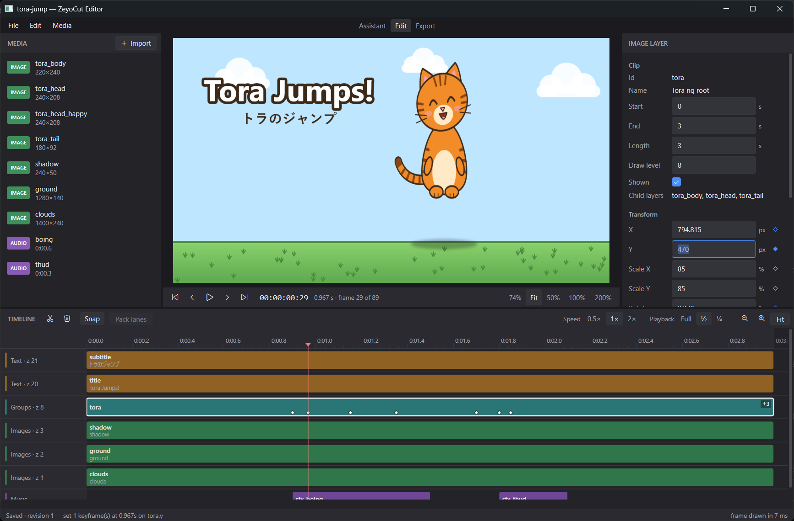
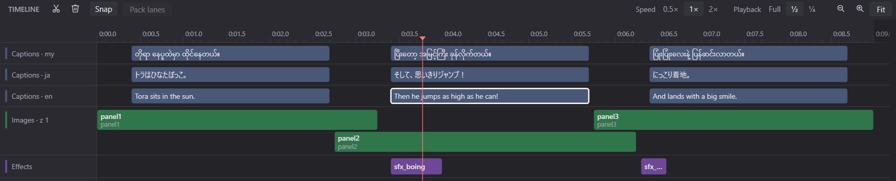

# The editor

`ZeyoCut.Editor.exe` opens a ZeyoCut project in a window, for fine-tuning by hand what the model made. It edits the same `project.json` as the server, at the same time: each change you make is saved at once and the model's next reply notes it, and what the model changes shows in the window within a second.

It imports media, plays the edit with its sound, moves, trims and splits clips on a timeline, places, crops and animates layers with keyframes, sets effects, color adjustments and face-blur settings, edits captions, changes volumes, and exports. Masks, motion paths, transitions and speed changes stay with the model: ask it for those.

## Open a project

`ZeyoCut.Editor.exe` is in the release zip, next to `ZeyoCut.Mcp.exe`; [Install](install.md#the-editor-optional) says how it finds FFmpeg and your projects. Then:

- The start page lists your projects folder and recent projects.
- Open project folder (Ctrl+O) opens any project folder, and so does dropping one on the start page.
- From the command line: `ZeyoCut.Editor.exe C:\Users\you\ZeyoCut\projects\my-video`.
- Or ask the model to open the project in the editor ([`open_in_editor`](GUIDE.md#open_in_editor)).

A project is open in one window at a time: opening it again brings that window to the front.

A `project.json` with problems still opens, such as one edited by hand whose asset names a file outside `assets\`. The status bar names the problems and the media list marks those files; changes and exports are refused until they're fixed.

The header across the top names the project and whether it's saved ("Saved · rev N"). The logo and **Projects** close the project and go back to the start page. In the middle, **Edit** and **Activity** switch views; on the right are Undo and Redo, when Claude last saved the project, and **Export**, which opens the Export view (Ctrl+1, Ctrl+2 and Ctrl+3 go to Activity, Edit and Export). The status bar at the bottom names the selected clip, counts the layers and lanes, and says what the last change did.

## Media

- Import, above the media list (Ctrl+I), imports images, audio, fonts and video. Video that needs normalizing (variable frame rate, rotation, HDR) is converted first, as `import_video` does, with its progress in the media list. Files you pick yourself can come from any folder; the import folders limit only what the model can read.
- Drag files from File Explorer onto the window to import them.
- Drag media from the list onto a lane of the timeline, or right-click it → Add at the playhead. A video or picture dropped on a picture lane is drawn at that lane's level, and anywhere else on a level of its own on top. Sound takes the role of the sound lane it's dropped on, else music.

## The preview

The preview draws the frame at the playhead with the same renderer as exports, from proxies for footage over 2560 px. Its header names the canvas ("16:9 · 1920×1080 · 30 fps"); the list on the right sets the zoom: Fit, 50%, 100% or 200%.

- The safe-area button draws the title-safe margin over the frame, and on a vertical canvas the strips the Shorts player covers, as `check_project` checks them. The grid button draws thirds. Both are drawn over the frame, never into it or the export, and the editor remembers them.
- F shows the frame on the whole screen; Esc or F leaves. Space plays there too, and ← and → step.

- Click a video, picture or text to select it: the one drawn on top there, a layer attached to a clip (a logo on a video, a part of a rig) too. Its box and anchor are outlined, and the timeline highlights the clip that holds it.
- Drag it to move it. The frame is redrawn as you drag, and the move is saved when you let go, as one undo step. Shift keeps it on one axis, and Escape puts it back. An animated position gets a keyframe at the playhead. A caption takes its whole track along. A layer on a motion path doesn't move: the path places it.
- The preview draws the layers of every language at once; the Export view exports one language's version.
- A paused frame is drawn again within a second or so when a file it shows changes without a save, such as the matte of a background Claude removed with an AI method. Until it is computed, the preview draws the clip with its background, and exports refuse to start.

## Playback

Space plays and pauses, at 0.5×, 1× or 2×, with the sound mixed as the export mixes it. After an edit that changes the sound, the mix is made again in the background; until it's ready, playback is silent and says "updating sound…". While playing, frames are drawn at half size (Preview: Full, ½ or ¼ res, under the frame), and when drawing can't keep up, every second frame is shown. A paused frame is always full size. With Loop on, playing past the last frame goes on from the first.

Under the frame are the playhead's timecode and the last frame's. ← and → step a frame (with Shift, a second), and Home and End go to the first and last frame. The status bar shows the frame number.

## The timeline

There's a lane for each draw level (`zIndex`) of video, images and text, the highest on top; a lane for each caption track; and Voice, Music and Effects lanes for sound. A layer with child layers (a logo attached to a clip, a rig) is one clip with a "+N" badge, and its children move, trim, split and delete with it.

- Click a clip to select it and see it in the inspector.
- Drag a clip sideways to move it, or drag its edges to trim it; a video can show more as far as its source goes. Drag a video, picture or text clip up or down onto another lane to change what it's drawn over, or between two lanes to give it a level of its own. Escape cancels the drag.
- Held at the left or right edge of the lanes, a drag scrolls them, faster the further in, so a clip can go anywhere in a long video. Scrubbing in the ruler does the same.
- Clips snap to clip edges, the playhead and markers. The Snap button turns it off.
- S (or Ctrl+B) splits the selected clip at the playhead, and Delete removes it with its child layers (a child layer selected in the preview is removed with its own children). Right-click a clip for these, for Hide and Show (Mute and Unmute for sound), and to turn a video's own sound off or on.
- Click or drag in the ruler to move the playhead. ↑ and ↓ jump to the previous and next clip edge.
- The ruler and the lanes are shaded past the project's end: the export stops there, so what runs past it is cut. The project's Duration in the inspector moves the end.
- The selected clip shows its layer's keyframes as white diamonds along its bottom edge. Click one to move the playhead there; Alt+← and Alt+→ jump to the previous and next.
- Ctrl+wheel or −/+ zooms, and Shift+Z fits the whole video. The wheel scrolls the lanes, and Shift+wheel scrolls in time.
- **Pack lanes** puts layers that never show at the same time on shared levels, so clips the model added one at a time stop taking a lane each. Every frame looks as before. When it can't save a lane, the button is off.

## The inspector

The inspector shows the selected clip and changes it. With nothing selected, it shows the project: its Duration is changed there, as `update_project` changes it, and the rest is shown.

Its header names the clip with a badge for its kind, and says where it comes from and what goes with it ("from street.mp4 · 1 child · 2 redactions"). The ⋯ button has the timeline's right-click menu: split, delete, hide or mute, and a video's sound. The fields are on tabs by kind, and the tab you chose stays chosen for the next clip that has it:

| Clip | Tabs |
|---|---|
| Video | Video, Audio, Speed, Effects, Color |
| Picture | Image, Effects, Color |
| Text | Text, Style, Effects |
| Sound | Audio |
| Caption | Caption, Style |

- **Timing:** Start, End and Length, on one row, move and trim it.
- **Clip:** Draw level is its `zIndex`; Shown hides it (Muted for sound).
- **Attached:** a chip for each child layer (a logo on a video, the parts of a rig), which selects it, and for each cutout and redaction that follows the clip.
- **Speed:** a video's speed, as `set_speed` sets it: 2 plays it twice as fast in half the time. The clips after it stay where they are.
- **Sound:** a video has Sound on, and sound has its role, volume and fades.
- **Text:** a text's words and its style: font (an installed family, or a font file imported into the project), size, bold, color, outline, alignment, maximum width, line height and a box behind it. A caption's text is its own, and its style is the whole track's: a change applies to every caption in the track, as one undo step.
- **Transform:** Position X and Y place the layer's anchor on the canvas (a child layer's, in its parent's pixels), Scale W and H size it in percent (negative flips it), Rotation turns it in degrees around the anchor, and Opacity is in percent, by its slider or typed. The slider saves when you let it go, as one undo step. A layer that follows a motion path shows Position: the path places it; ask the model to change the path. A caption's X and Y move every caption in its track by the same amount.
- **Crop:** a video's Left, Top, Right and Bottom cut that many pixels of its file off each side. What's left of the picture stays where it was, and so do child layers on it. A crop the model animated is changed with keyframes; ask the model.
- **Effects:** Blur, Shadow, Border (the outline effect) and Tint switch an effect on and off, as `set_effect` does. Switched on, each shows its settings: the blur's size each way; the shadow's color, offset, softness and opacity; the border's color and width; the tint's color and amount (a new tint is white). Captions don't have them.
- **Color:** a video's or picture's Brightness, Contrast and Saturation, in percent: 0, 100 and 100 leave it as it is.
- **Face blur:** a video whose footage a redaction hides (`apply_redaction`) shows its settings: Style, Strength (pixelate and blur) or Fill color (solid), Padding, Feather and Hold frames, a section for each redaction. They are the redaction's, so they change every clip of that footage.

### Typing values

Enter saves a field, and so does clicking or tabbing away; Escape puts it back. In a text, Shift+Enter starts a new line.

While the keyboard is in a field, Ctrl+Z and Ctrl+Y undo and redo what you typed there. They don't reach the project's saved changes until you leave the field, also when nothing typed is left to take back.

Numbers take a point or a comma, with or without their unit: `2,5`, `2.5 s`, `40px`, `50%` and `15°` all work. A value the project can't take is refused with the reason, and the field shows what's saved.

### Keyframes

The diamond beside a number animates it. ◇ adds a keyframe at the playhead with the value shown; ◆ means there's one at the playhead, and takes it away. Blue means the value is animated. Taking away the last keyframe leaves the value it had there. Position and Scale have one diamond for both values: it keys both, or takes both keyframes away when both are there.

A value animated with keyframes shows its value at the playhead. Changing it adds a keyframe there (or changes the one on that frame), with the easing of the keyframe before it, so the move keeps its feel. That needs the playhead where the layer is. Clicking into an animated value or pressing its diamond while playing stops the playback first, so the change goes on the frame you see.

To blur seconds 2 to 4, say:

1. At 2 s, switch Blur on, set it to 0 and press ◇.
2. At 2.5 s, type 8.
3. At 3.5 s, press ◇.
4. At 4 s, type 0.

## Export

Export in the header (Ctrl+3) opens the Export view, and Back to edit returns to the timeline. It renders the project as it's saved to an MP4 in its `exports` folder, as the model's `start_export` does, in the editor's own process: with the project's settings or a preset of the same shape, and one language's version when layers are tagged with languages. Edits made while it runs aren't in it.

It shows the progress, Stop ends it, and Show in folder opens File Explorer on the file. Replacing a file asks first, and closing the window or the project while an export runs asks whether to stop it. The files already in the `exports` folder are listed below; click one to show it.

## Working with the model

- **Every change is saved at once**, as one step that Ctrl+Z undoes and Ctrl+Y redoes. The header shows "Saved · rev N" and the status bar what the last change did; there's no Save button. The header says "Saving…" while a change is being saved: when the server is saving at that moment, your change is saved after it (it waits up to 5 s), and the window goes on working meanwhile. Split, Delete, Pack lanes, a keyframe diamond and Export, pressed meanwhile, wait for it and then act on the project as saved, and closing the window hides it at once and lets the change finish saving before it closes.
- When a change can't be saved, because another program holds `project.json` or its folder is read-only or gone, the change isn't made and the status bar says why. Make it again once the file can be written.
- If the editor runs into an error it didn't expect, it says so in plain words and goes on; your changes before it are saved. The details are added to `editor-errors.log` in the log folder (`%LOCALAPPDATA%\ZeyoCut\logs` by default): include them when you report the problem.
- When the server saves the project, the editor shows the new version and says what changed. The server's next reply lists what the editor changed. Undo on either side takes back only its own changes. See [Saving alongside another program](project-format.md#saving-alongside-another-program).
- Ctrl+Z can't take back your change to a layer the server changed after it: that would throw the server's change away, and the status bar says so. The next Ctrl+Z steps over that change, which stays as it is, undoes the one before it and names the one it stepped over. Ctrl+Y does the same with a change it can't put back.
- A change you began before the server's isn't saved over it. If the server changes a layer while you're typing in one of its fields or dragging it, your change isn't saved and the status bar says "Your change wasn't saved: another program changed '…' first". What you typed stays in the field: Enter saves it over the server's change, Escape drops it.
- The header says when Claude last saved the project ("Claude saved 3 min ago"); hover over it for what it changed.
- The **Activity** view (Ctrl+1) shows the revision, who saved it last, and the 20 most recent saves, each marked You or Claude.

## Keys

| Key | What it does |
|---|---|
| Space | Play and pause |
| F | The frame on the whole screen; Esc or F leaves |
| ← / → | The previous and next frame; with Shift, a second |
| Home / End | The first and last frame |
| ↑ / ↓ | The previous and next clip edge |
| Alt+← / Alt+→ | The selected clip's previous and next keyframe |
| S or Ctrl+B | Split the selected clip at the playhead |
| Delete | Delete the selected clip with its child layers |
| Escape | Cancel a drag, else clear the selection; in a field, put it back |
| − / + | Zoom the timeline out and in (also Ctrl+wheel) |
| Shift+Z | Fit the whole video in the timeline |
| Ctrl+Z / Ctrl+Y | Undo and redo; in a field, the typing there |
| Ctrl+1 / Ctrl+2 / Ctrl+3 | Activity, Edit and Export |
| Ctrl+O | Open a project |
| Ctrl+I | Import media |

## Settings

The editor reads `FfmpegPath`, `ProjectsRoot`, `LibraryPath` and `VideoEncoder` from the same `appsettings.json` and environment variables as the server (see [Configuration](https://github.com/zeyarwinthu/zeyocut#configuration)). It keeps its own settings (recent projects, panel sizes, window position, snapping, playback size) in `%LOCALAPPDATA%\ZeyoCut\editor.json`, or the file `ZEYOCUT_EDITOR_SETTINGS` names, never in the project.

## What it leaves to the model

- Masks, motion paths, transitions and speed changes.
- Closing a gap: deleting a clip leaves one. The model's `remove_range` cuts a stretch of time out of every layer.
- Clips show no thumbnails or sound waveforms, and one clip is selected at a time.
