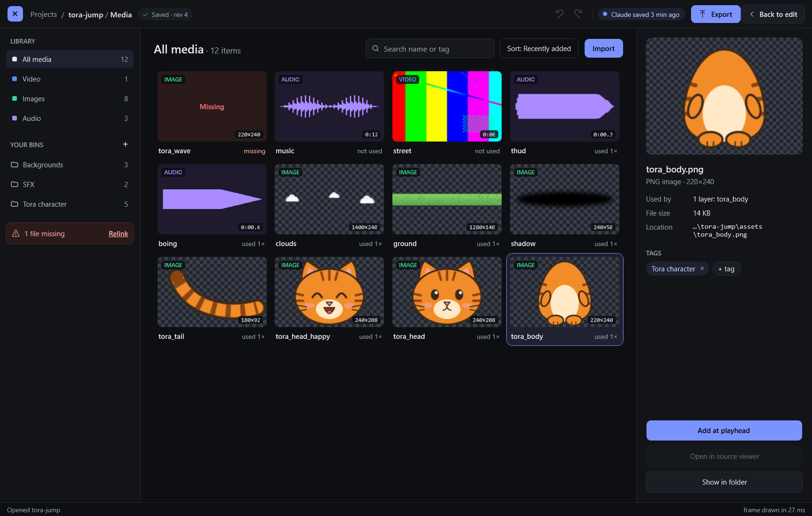
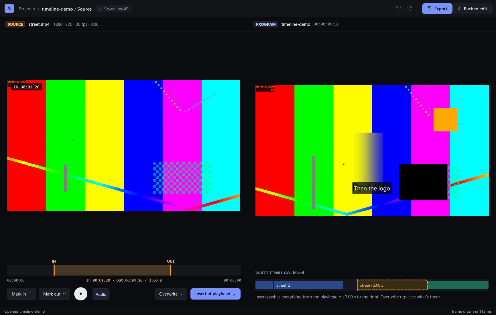
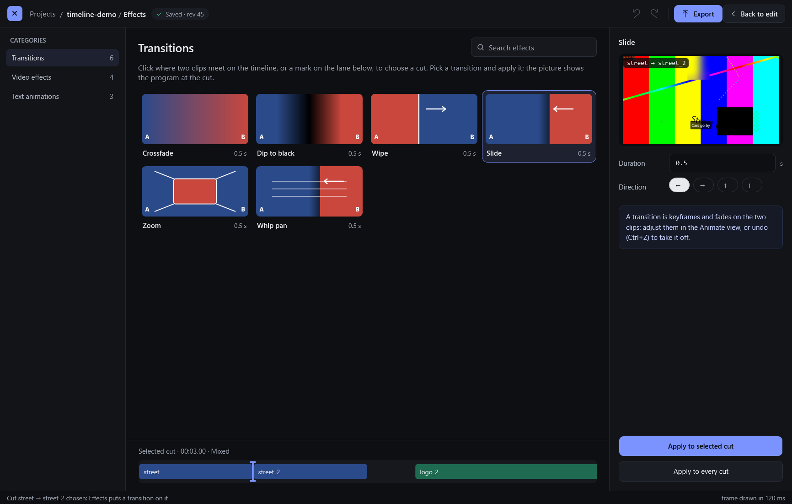
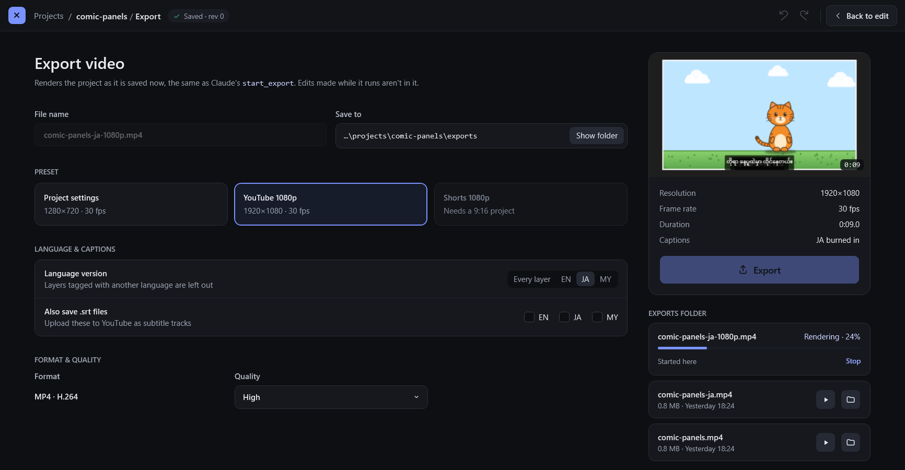
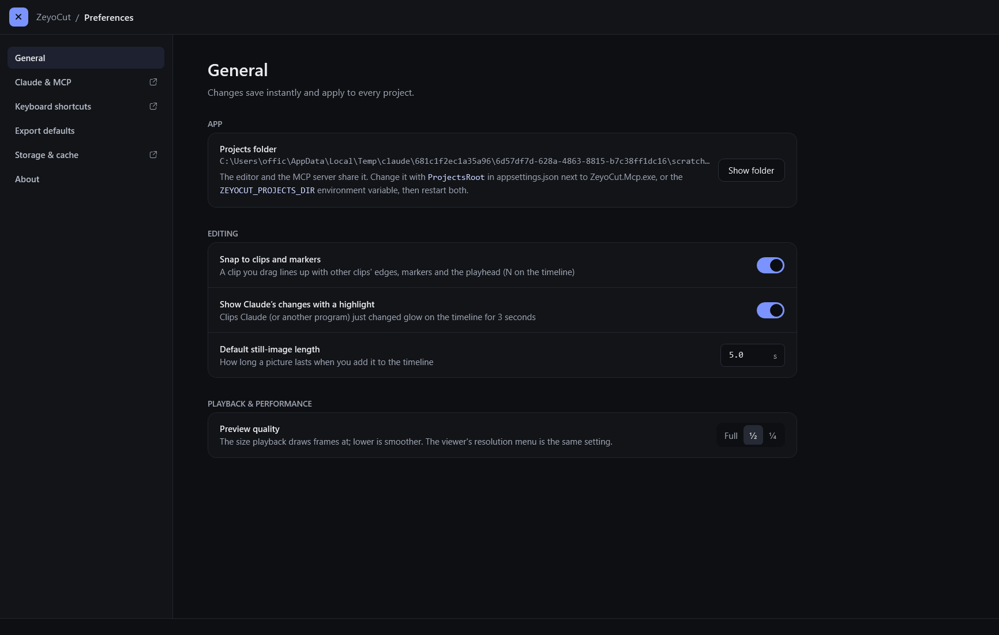

# The editor

`ZeyoCut.Editor.exe` opens a ZeyoCut project in a window, for fine-tuning by hand what the model made. It edits the same `project.json` as the server, at the same time: each change you make is saved at once and the model's next reply notes it, and what the model changes shows in the window within a second.

It imports, browses and tags media, plays the edit with its sound, marks the part of a video or sound to use and inserts or overwrites it at the playhead, moves, trims and splits clips on a timeline, places, crops and animates layers with keyframes, retimes and eases keyframes on a dope sheet or as curves, sets effects, color adjustments and face-blur settings, grades a clip's color with the clip as shot beside it and scopes, tracks objects in footage and hides them with corrections where the tracker lost them, puts transitions on cuts, adds titles in the library's styles and its templates with a way in and out, edits captions, changes volumes and a video's speed, mixes the sound roles with volume keyframes and ducking, and exports, one after another in a render queue. Masks and motion paths stay with the model: ask it for those.

## Open a project

`ZeyoCut.Editor.exe` is in the release zip, next to `ZeyoCut.Mcp.exe`; [Install](install.md#the-editor-optional) says how it finds FFmpeg and your projects. Then:

- **Home**, the start page, shows your recent projects and then the rest of your projects folder. Each card has a picture of the project (its frame a second in, kept in the project's `cache\thumbnails` folder and drawn again once it's saved), its length, how many languages it's in, and "Claude edited 2 min ago" when Claude saved it last that day. The full folder is in its tooltip.
- The search box keeps the projects whose names have what you type, and the buttons on the right show them as cards or as a list. Show folder, at the bottom, opens the projects folder. The settings button left of the search box opens [Preferences](#preferences).
- Open folder… (Ctrl+O) opens any project folder, and so does dropping one on Home.
- **New project…** (Ctrl+N), or the Landscape, Shorts / Reels and Square cards under Start something new (each opens it with its canvas chosen), makes a project in the projects folder. It takes a name and a blank canvas (YouTube 1920×1080, HD 720p, Shorts 1080×1920, Square, Portrait 4:5 or any size typed in), a frame rate (24, 25, 30 or 60) and a background (black, white, sky blue or transparent). It can also start from a template in the library, which brings its own canvas, frame rate and background. The preview shows the canvas's shape with its safe area and says which export preset fits it. It makes the same `project.json` as `create_project` (or `new_project_from_template`) with those values, then opens it.
- From the command line: `ZeyoCut.Editor.exe C:\Users\you\ZeyoCut\projects\my-video`.
- Or ask the model to open the project in the editor ([`open_in_editor`](GUIDE.md#open_in_editor)).

A project is open in one window at a time: opening it again brings that window to the front.

A `project.json` with problems still opens, such as one edited by hand whose asset names a file outside `assets\`. The status bar names the problems and the media list marks those files; changes and exports are refused until they're fixed.

When a project opens with files missing (moved or renamed), the **Relink** view lists each one, where it was and how many clips use it. It looks for each in the project folder and the import folders, up to four folders down, for a file of the same name and kind with the same pixel size, the same length (within a frame) or the same font family, and offers what it finds. Search another folder… looks in a folder you pick, Choose file… takes any file of the same kind, and Leave it missing skips one. Relink and open copies the chosen files into `assets\` and points the assets at them, as `relink_asset` does, as one step Ctrl+Z undoes. Open without relinking leaves them missing; a missing tile's right-click menu has Relink… for later. Footage that needs normalizing (variable frame rate, rotation, HDR) is refused: import it instead and use the new asset.

The first time the editor starts, when it has no settings file yet, the **Welcome** view shows the projects folder and how to connect Claude: the `zeyocut` entry for Claude Desktop's `claude_desktop_config.json`, with the path of the `ZeyoCut.Mcp.exe` next to the editor, to copy, or the bundle to install instead. Its Connect step turns green when a client lists the server's tools after the Welcome opened (the server notes the last one in `connected.json` in its log folder). The last step copies the sample `examples\tora-jump` into the projects folder, unless a project of that name is there already, and opens it. Skip setup, or I'll do this later, goes to Home, and the Welcome doesn't open again.

The header across the top names the project and whether it's saved ("Saved · rev N"). The logo and **Projects** close the project and go back to Home. In the middle, **Edit**, **Audio**, **Animate**, **Track & blur**, **Captions** and **Activity** switch views; on the right are Undo and Redo, when Claude last saved the project, and **Export**, which opens the Export view (Ctrl+1 to Ctrl+6 go to Edit, Audio, Animate, Track & blur, Captions and Activity, and Ctrl+E to Export; ? or F1 lists every key). The Media browser, the source viewer, Titles, Effects and Color, like Export, have Back to edit in place of the views. The status bar at the bottom names the selected clip, counts the layers and lanes, and says what the last change did.

## Media

The media panel shows a tile for each asset: a picture made small, a video's first frame, a sound's waveform, "Aa" for a font and hues and grays drawn through a LUT, with the length of footage and sound, and a dot in the kind's color. The name under a tile is the asset's id, which is what Claude calls it; the file name is in its tooltip, and a file that's gone is marked Missing in red. The chips All, Video, Images, Audio (and Fonts and Looks, when the project has a font or a LUT) show one kind. Thumbnails and waveforms are made in the background and kept in the project's `cache\thumbnails` and `cache\waveforms` folders; a file that changes gets new ones.

- Import, above the media list (Ctrl+I), imports images, audio, fonts, LUTs (`.cube`) and video. Video that needs normalizing (variable frame rate, rotation, HDR) is converted first, as `import_video` does, with its progress in the media list. Files you pick yourself can come from any folder; the import folders limit only what the model can read.
- Drag files from File Explorer onto the window to import them.
- Drag media from the list onto a lane of the timeline, or right-click it → Add at the playhead. A video or picture dropped on a picture lane is drawn at that lane's level, and anywhere else on a level of its own on top. Sound takes the role of the sound lane it's dropped on, else music.
- Double-click a video or a sound to open it in the [source viewer](#the-source-viewer). On the rail beside the panel, **Media** opens the [Media browser](#the-media-browser), and **Titles**, **Effects** and **Color** open the [Titles](#titles), [Effects](#effects) and [Color](#color) views.

### The Media browser

The Media browser shows the project's media as cards: each file's picture, kind, pixel size or length, name, and how many layers use it ("used 2×", "not used") or "missing".

- **Library** on the left shows every file or one kind (Video, Images, Audio, and Fonts and Looks when there's one), with how many each has. **Your bins** are the files' tags, the same tags `tag_assets` gives them and `list_assets` shows: a bin shows the files with its tag. + makes a bin of the selected files; right-click a bin → Remove bin takes its tag off its files, which stay in the project.
- When files are missing, "N files missing · Relink" opens the [Relink](#open-a-project) view for them.
- The search box keeps the files whose name, file name or tags have every word typed. **Sort** puts the newest imports first (Recently added), the oldest first, or by name. Import (Ctrl+I) imports as the media panel does.
- Click a card to see the file's details on the right: its kind and size, the layers that use it, the file's size and where it is, and its tags, each with × to take it off and + tag to add one. Ctrl and Shift select several files, to tag them together. Each tag change is one undo step.
- **Add at playhead** adds the file at the playhead as the media panel's menu does, **Open in source viewer** opens a video or sound in the source viewer (so does double-clicking its card), and **Show in folder** shows the file in File Explorer.

### The source viewer

The source viewer shows a video or a sound on its own (its frames drawn by the same renderer as exports, its sound as the file has it) on the left, and the edit at the timeline's playhead on the right.

- Space plays the file and pauses it, ← and → step a frame (with Shift, a second), Home and End go to its first and last frame, and the scrubber under it moves through it.
- **Mark in** (I) and **Mark out** (O) mark the part to use: the clip starts at the in frame and ends with the out frame, so the marks become its trim in and out. Alt+X clears them. Without marks, the clip is the whole file. The marks and the part's length are under the scrubber.
- **Audio**, for footage, adds the clip with its sound or without it (its sound off, as `update_layer`'s `muted`).
- **Where it will go** names the lane the clip goes on: the lane of the clip selected on the timeline, else the lowest one with video (Video 1), else the lowest one, else a new track on top; for a sound, its role, Music unless a sound's clip is selected. Click the name to choose another. Under it is the lane around the playhead with the new clip; click it to move the playhead.
- **Insert at playhead** (,) puts the part there, as `add_video_layer` with `edit` `insert` does: the clip under the playhead on that lane is split, and everything from the playhead on moves later by the part's length, with markers and the camera's keys. **Overwrite** (.) puts it over what the lane has there, cutting it, as `edit` `overwrite` does. Either is one undo step, selects the new clip, and moves the playhead to its end for the next one.

## Titles

**Titles** on the media panel's rail shows the library's text styles and templates, each drawn by the renderer: a style as its name in its look, on the canvas size it was saved for, and a template as its project at its first frame. **All**, **Your styles** and **Templates** choose what shows. Styles and templates are made by the model (`save_style`, `save_template`), into the library it shares with the editor.

- With no text selected, the panel on the right sets up a **New title**: Line 1, Line 2 (empty for one line), the fill and outline colors (#RRGGBB; the outline empty for none), and **Animate in** and **Animate out** (None, Fade, Pop or Slide up). Click a style first to start from its look and colors. **Add at playhead** adds it for 4 seconds (or to the video's end), centered, as `add_text_layer` with `style`, `animateIn` and `animateOut` does, as one undo step, and selects it.
- With a title selected (a text that isn't a caption), the fields are its own and each change is saved as you make it: Enter or leaving a field saves the lines or colors as `update_layer` does, and choosing a preset puts its keyframes on, as `add_text_layer`'s presets do, in place of the ones there. A title whose keyframes at its start or end aren't a preset shows Keyframes. **Apply 'Style'** gives it the chosen style's look, keeping its words, place and timing, as `apply_style` does. **Update saved style** saves its look over the chosen style in the library, as `save_style` does; that isn't an undo step. **New title** leaves it and sets up a new one.
- Click a template to see its layers. **Add at playhead** puts them in from the playhead as a block, as `add_template` does: on levels above the project's, with new ids where the project has them already, and its files brought in (or reused when the project has them).

## Effects

**Effects** on the media panel's rail has three categories on the left, with search over their names.

- **Transitions**: Crossfade, Dip to black, Wipe, Slide, Zoom and Whip pan, as `add_transition` makes them. To choose a cut, click where a clip meets the next on its lane in the timeline (the end of one or the start of the other) without dragging; it's marked in the accent color. The strip under the tiles shows the lane around the cut with each cut marked, and clicking a mark chooses that one. The picture on the right is the program at the cut, so it shows the result once applied. **Duration** is in seconds (0.5 unless typed), and **Direction** is where the new picture comes from (from the right, left, bottom or top), or In and Out for a zoom. **Apply to selected cut** puts it on the chosen cut; **Apply to every cut** puts it on each cut of that lane (or the selected clip's) as one undo step. A transition overlaps the two clips, so the project may get shorter, and its keyframes and fades can be adjusted in Animate; Ctrl+Z takes it off.
- **Video effects**: Blur, Shadow, Border and Tint go on the selected picture, text or video, or come off it, as the inspector's switches do. Their settings are in the inspector.
- **Text animations**: Fade, Pop and Slide up, for how the selected title, picture or video comes in at its start (**Use to come in**) or goes out at its end (**Use to go out**), as the Titles view's presets.

## Color

**Color** on the media panel's rail grades a clip as `set_color` does, and so does Color… on a clip's right-click menu. It works on the selected video or picture, else on the one drawn on top at the playhead; the header names it, and says so when it isn't at the playhead. ← and → step through frames and Home and End go to the first and last, but the view doesn't play.

- **The viewer** draws the frame at the playhead with the same renderer as exports. **After** shows the clip as graded, **Before** as shot, and **Split** both, as shot left of the line and graded right of it; drag across the frame to move the line. The line and its tags are never in the frame or the export.
- **Adjust** has Exposure in stops (−3 to +3) and Contrast, Highlights, Shadows, Temperature, Tint and Saturation from −100 to +100; 0 leaves the clip as it is. Contrast and saturation are the inspector's percentages less 100: +12 is 112%. The frame follows a slider while you drag it, and the change is saved when you let go, as one undo step. Click a value to type one (`+0.3`, `-20`, `15%`): typed, contrast and saturation go up to +300, and a value `set_color` doesn't take is refused with its range. A value with keyframes gets a keyframe at the playhead instead.
- **Look (LUT)** lays a 3D LUT over the clip after the rest of its color, as `set_color`'s `look` does. Its menu lists the project's LUTs and None, which takes the look off; **Import .cube…** copies a `.cube` file into the project (as the media panel's Import does) and gives the clip its look. The button names the look and how much of it shows ("warm_sunset · 60%"), and **Amount** under it, there while the clip has a look, sets that from 0% to 100%.
- **The wheels** under the viewer move red, green and blue in one part of the picture: **Shadows** (lift: black moves, white stays), **Midtones** (gamma: black and white stay) and **Highlights** (gain: white moves, black stays). Drag a wheel's puck toward a color to add it there and take its opposite away; a double-click puts the puck back in the middle. The slider under a wheel moves the three channels together, and the readout shows them in hundredths (R −2 G 0 B +4). The frame follows the drag, and the change is saved when you let go, as one undo step; a wheel with keyframes gets them at the playhead.
- **Reset all** puts the clip back as shot, with no grade, wheels or look and its contrast and saturation at 100%, as `set_color` with `reset` does.
- **Copy grade** remembers the clip, and **Paste grade** gives its color to the clip shown, as `set_color` with `from` does. **Apply to all street clips**, named for the clip's file, gives every clip of the same video or picture this clip's color, as `sameFootage` does. Each is one undo step.
- **Waveform** draws the frame's brightness column by column, black at the bottom and white at the top, with lines at a quarter, half and three quarters. **Vectorscope** draws its colors by hue around the middle and by strength out from it, gray in the middle. Both are of the frame the viewer shows as graded, so they follow a slider as it moves.

## The preview

The preview draws the frame at the playhead with the same renderer as exports, from proxies for footage over 2560 px. Its header names the canvas ("16:9 · 1920×1080 · 30 fps"); the list on the right sets the zoom: Fit, 50%, 100% or 200%.

- The safe-area button draws the title-safe margin over the frame, and on a vertical canvas the strips the Shorts player covers, as `check_project` checks them. The grid button draws thirds. Both are drawn over the frame, never into it or the export, and the editor remembers them.
- F shows the frame on the whole screen; Esc or F leaves. Space plays there too, and ← and → step.

- Click a video, picture or text to select it: the one drawn on top there, a layer attached to a clip (a logo on a video, a part of a rig) too. Its box and anchor are outlined, and the timeline highlights the clip that holds it.
- Drag it to move it. The frame is redrawn as you drag, and the move is saved when you let go, as one undo step. Shift keeps it on one axis, and Escape puts it back. An animated position gets a keyframe at the playhead. A caption takes its whole track along. A layer on a motion path doesn't move: the path places it.
- When layers are tagged with languages, the preview draws one language's version, as an export in that language does: the list in its header (EN, JA) picks it, for the Captions view too, and the editor remembers it. English comes first, else the first language. The timeline shows every language's clips.
- A paused frame is drawn again within a second or so when a file it shows changes without a save, such as the matte of a background Claude removed with an AI method. Until it is computed, the preview draws the clip with its background, and exports refuse to start.

## Playback

Space plays and pauses, at 0.5×, 1× or 2×, with the sound mixed as the export mixes it. After an edit that changes the sound, the mix is made again in the background; until it's ready, playback is silent and says "updating sound…". While playing, frames are drawn at half size (Preview: Full, ½ or ¼ res, under the frame), and when drawing can't keep up, every second frame is shown. A paused frame is always full size. With Loop on, playing past the last frame goes on from the first.

Under the frame are the playhead's timecode and the last frame's. ← and → step a frame (with Shift, a second), and Home and End go to the first and last frame. The status bar shows the frame number.

## The timeline

There's a lane for each draw level (`zIndex`) of video, images and text, the highest on top; a lane for each caption track ("Captions · EN"); and Voice, Music and Sound effects lanes for sound. A draw level is named for what it holds (Video, Images, Text, or Mixed), and levels of the same name are numbered from the bottom: Video 2 draws over Video 1. The lane's tooltip gives its draw level. A layer with child layers (a logo attached to a clip, a rig) is one clip with a "+N" badge, and its children move, trim, split and delete with it.

Clips are drawn in their kind's color, a video's or picture's with its thumbnail at the start, and a sound's with its waveform from where it's trimmed. A hidden clip, or muted sound, is faded with a dashed edge and a crossed-out eye or speaker.

- Click a clip to select it and see it in the inspector.
- The eye beside a lane's name hides every clip in it, as one step to undo, and shows them all again once all are hidden. On a sound lane it's a speaker that mutes them.
- The Blade tool (B) splits a clip where you click it: a line shows where. Select (V, or Escape) goes back to moving and trimming.
- Add marker (M) puts a chapter marker at the playhead, as `add_markers` does, named Marker 1, Marker 2 and so on. Ask Claude to rename or remove markers.
- Drag a clip sideways to move it, or drag its edges to trim it; a video can show more as far as its source goes. Drag a video, picture or text clip up or down onto another lane to change what it's drawn over, or between two lanes to give it a level of its own. Escape cancels the drag.
- Held at the left or right edge of the lanes, a drag scrolls them, faster the further in, so a clip can go anywhere in a long video. Scrubbing in the ruler does the same.
- Clips snap to clip edges, the playhead and markers. The Snap button (N) turns it off.
- S (or Ctrl+B) splits the selected clip at the playhead, and Delete removes it with its child layers (a child layer selected in the preview is removed with its own children). Right-click a clip for these, for Hide and Show (Mute and Unmute for sound), to turn a video's own sound off or on, and for Color… on a video or picture, which opens the [Color](#color) view on it. Ctrl+D duplicates the selected clip with its child layers, as `duplicate_layer` does, and selects the copy.
- Click or drag in the ruler to move the playhead. ↑ and ↓ jump to the previous and next clip edge.
- The ruler and the lanes are shaded past the project's end: the export stops there, so what runs past it is cut. The project's Duration in the inspector moves the end.
- The selected clip shows its layer's keyframes as white diamonds along its bottom edge. Click one to move the playhead there; Alt+← and Alt+→ jump to the previous and next.
- Ctrl+wheel, −/+ or the zoom slider zooms, and Fit (Shift+Z) fits the whole video. The wheel scrolls the lanes, and Shift+wheel scrolls in time.
- **Pack lanes** puts layers that never show at the same time on shared levels, so clips the model added one at a time stop taking a lane each. Every frame looks as before. When it can't save a lane, the button is off.

## The inspector

The inspector shows the selected clip and changes it. With nothing selected, it shows the project: its Duration is changed there, as `update_project` changes it, and the rest is shown.

Its header names the clip with a badge for its kind, and says where it comes from and what goes with it ("from street.mp4 · 1 child · 2 redactions"). The ⋯ button has the timeline's right-click menu: split, delete, hide or mute, a video's sound, and Color…. The fields are on tabs by kind, and the tab you chose stays chosen for the next clip that has it:

| Clip | Tabs |
|---|---|
| Video | Video, Audio, Speed, Effects, Color |
| Picture | Image, Effects, Color |
| Text | Text, Style, Effects |
| Sound | Audio |
| Caption | Caption, Style |

- **Timing:** Start, End and Length, on one row, move and trim it.
- **Clip:** Draw level is its `zIndex`; Shown hides it (Muted for sound).
- **Attached:** a chip for each child layer (a logo on a video, the parts of a rig), which selects it, and for each cutout and redaction that follows the clip.
- **Speed:** a video's speed, as `set_speed` sets it: 2 plays it twice as fast in half the time. The clips after it stay where they are.
- **Sound:** a video has Sound on, and sound has its role, volume and fades.
- **Text:** a text's words and its style: font (an installed family, or a font file imported into the project), size, bold, color, outline, alignment, maximum width, line height and a box behind it. A caption's text is its own, and its style is the whole track's: a change applies to every caption in the track, as one undo step.
- **Transform:** Position X and Y place the layer's anchor on the canvas (a child layer's, in its parent's pixels), Scale W and H size it in percent (negative flips it), Rotation turns it in degrees around the anchor, and Opacity is in percent, by its slider or typed. The slider saves when you let it go, as one undo step. A layer that follows a motion path shows Position: the path places it; ask the model to change the path. A caption's X and Y move every caption in its track by the same amount.
- **Crop:** a video's Left, Top, Right and Bottom cut that many pixels of its file off each side. What's left of the picture stays where it was, and so do child layers on it. A crop the model animated is changed with keyframes; ask the model.
- **Effects:** Blur, Shadow, Border (the outline effect) and Tint switch an effect on and off, as `set_effect` does. Switched on, each shows its settings: the blur's size each way; the shadow's color, offset, softness and opacity; the border's color and width; the tint's color and amount (a new tint is white). Captions don't have them.
- **Color:** a video's or picture's Brightness, Contrast and Saturation, in percent: 0, 100 and 100 leave it as it is. A graded clip shows its grade under them ("exposure 0.3, highlights -0.2, shadows 0.18, temperature 0.35"), which the [Color](#color) view changes.
- **Face blur:** a video whose footage a redaction hides (`apply_redaction`) shows its settings: Style, Strength (pixelate and blur) or Fill color (solid), Padding, Feather, Hold frames, Shape and Smooth, a section for each redaction. They are the redaction's, so they change every clip of that footage. The Track & blur view sets most of them too.

### Typing values

Enter saves a field, and so does clicking or tabbing away; Escape puts it back. In a text, Shift+Enter starts a new line.

While the keyboard is in a field, Ctrl+Z and Ctrl+Y undo and redo what you typed there. They don't reach the project's saved changes until you leave the field, also when nothing typed is left to take back.

Numbers take a point or a comma, with or without their unit: `2,5`, `2.5 s`, `40px`, `50%` and `15°` all work. A value the project can't take is refused with the reason, and the field shows what's saved.

### Keyframes

The diamond beside a number animates it. ◇ adds a keyframe at the playhead with the value shown; ◆ means there's one at the playhead, and takes it away. Blue means the value is animated. Taking away the last keyframe leaves the value it had there. Position and Scale have one diamond for both values: it keys both, or takes both keyframes away when both are there.

A value animated with keyframes shows its value at the playhead. Changing it adds a keyframe there (or changes the one on that frame), with the easing of the keyframe before it, so the move keeps its feel. That needs the playhead where the layer is. Clicking into an animated value or pressing its diamond while playing stops the playback first, so the change goes on the frame you see.

To blur seconds 2 to 4, say:

1. At 2 s, switch Blur on, set it to 0 and press ◇.
2. At 2.5 s, type 8.
3. At 3.5 s, press ◇.
4. At 4 s, type 0.

## Audio

**Audio** in the header (Ctrl+2) mixes the sound. The playback keys work here as in the Edit view.

- **A strip for each sound role:** Voice (narration and every video's own sound), Music and Sound effects. Its fader sets the role's level in dB, from -60 to +6, on top of each clip's volume: drag the handle, or press Up and Down for half a dB and Page Up and Page Down for 3; double-click or Home puts it back at 0. **Pan** places the role from left to right (Left and Right step 5%, double-click or Home centers it), and **M** mutes it. Each is saved in the project as `update_project` saves it, and exports and the preview mix it, one undo step each.
- **S** (solo) plays only the soloed roles in the preview. It's never saved and never changes an export, and it lasts until the project closes.
- **Master** shows the loudest of each side of the mix while it plays, in dBFS, and the effects every export has: loudness normalization to the target and the true-peak limit.
- **Loudness:** the target every export is normalized to (YouTube -14, Podcast -16, Broadcast -23 LUFS, or off), and **Measure**, which mixes the sound as the export does and measures it as `audio_levels` does: the loudness, the loudest sample, how far the mix is from the target before normalizing, and what `audio_levels` flags. There's no Normalize button: every export is normalized already.
- **Music track:** **Auto-duck under speech** lowers the music wherever a voice clip plays, by **Duck by** dB (0 to 40), going down over **Fade in** seconds before the voice starts and back up over **Fade out** seconds after it ends.
- **Volume automation** has a lane for each role with its clips and their waveforms, and each clip's volume as a line. Press the line to add a point at the level it has there, or press and drag to add it louder or quieter; drag a point to change its level, on the fader's scale to half a dB, and its time by whole frames. Delete takes the selected point away. These are the clip's `volume` keyframes, as `set_keyframes` sets them. Where ducking lowers the music, its clips are shaded, darker the deeper it goes. Clicking a clip off its line selects its layer and moves the playhead there.
- Equalizing, noise reduction, reverb and other sound effects aren't part of ZeyoCut.

## Animate

**Animate** in the header (Ctrl+3) is for timing a move. The playback keys work here as in the Edit view.

- **The list on the left** has every layer with keyframes, under the layers it's attached to, and the camera when it moves; the selected layer is there even before it has any. ▸ opens a layer to its animated values, each with its value at the playhead (794.8, 120%, 5°), and an image layer's drawing changes (a head's `normal` and `happy`) are a value of their own. A layer's name selects it, as clicking its clip does.
- **Dope sheet** puts each value's keyframes on its row, and a layer's row has them all. Click a key to select it; Ctrl adds or takes one away, Shift adds, and clicking a value's name selects its keys. Drag keys to retime them: they move by whole frames and keep their values and easings, as one undo step. A key can't land on another's time. Clicking the ruler or an empty place moves the playhead.
- **Graph** draws the selected layer's values as curves, each fitted to the height, from the interpolation exports use; click a value in the list to add or take away its curve (up to six). Position Y and other values that grow down the frame are drawn the way the layer moves, so a jump goes up. Drag a key to change its time and its value; Shift keeps to one of the two. **Fit curves** fits the ruler to the curves' keys rather than the whole video.
- **Linear**, **Smooth** (ease in and out, F9) and **Hold** set the easing of the selected keys: how the value goes from each to the next key.
- **Easing** on the right has the eight easings as tiles, the selected keys' one marked; a tile sets it at once. **Custom bezier** takes a curve as CSS's `cubic-bezier()` does (x1 and x2 from 0 to 1, y1 and y2 past 0 or 1 to overshoot), and **Apply to selection** gives it to the selected keys, as `set_keyframes` does with easing `cubicBezier`.
- **Onion skin** draws the selected layer with the layers under it at the frames around the playhead: 3 before and 2 after, fainter the further they are, the ones after in green. The menu beside it sets how many, up to five each way, and Alt+O turns it off and on. It shows while paused and is never in an export.
- **Motion path** draws the selected layer's path across the frame: where its anchor goes, with a dot at each keyframe. Moving the path is the model's.
- **Alt+K** adds a keyframe at the playhead to the value clicked last in the list, or to the selected layer's position. **Delete** takes the selected keys away, and **Escape** clears them.

## Track & blur

**Track & blur** in the header (Ctrl+4) follows things in footage and hides them, as `track_object`, `reanchor_track` and `apply_redaction` do. It works on the selected video clip when it's at the playhead, else on the top clip there. ← and → step through frames and Home and End go to the first and last, but the view doesn't play.

- **The list on the left** has the clip's footage's tracked objects: each one's name and kind (a face or plate `detect_and_track` found, or an object a box was drawn on), how it's hidden, its time on the clip, and a bar of the frames tracked (green) and those the tracker lost or wasn't sure of (orange). The first such stretch is named under it ("Lost for 10 frames at 8.8 s") with **Fix**, which goes to its first frame. Clicking an object chooses it and goes to its first frame when its box isn't on the one showing.
- **Draw a box to track**, then drag over the object in the viewer. **Backward** tracks the box from its frame to the clip's start and **Forward** to its end, as `track_object` does (method `csrt`), in the background with progress and **Stop**; Esc drops the box. A new object isn't hidden until you choose how.
- **The viewer** draws each object's box on the frame with how sure the tracker was ("track_1 · 96%", "lost", or "set by hand" on a frame where a box was drawn or corrected), and the chosen one's path over the last 12 frames. **Boxes** shows the frame without its redactions, **Result** as it exports, and **Split** both, the original on the left.
- **Correcting:** drag the chosen object's box, or one of its corners, to where the object is. The track is corrected on that frame and tracked again from there to the next box set by hand, as `reanchor_track` does, and Ctrl+Z takes the correction back. A face's or plate's boxes are found on every frame and can't be moved: draw a box where one was missed and track that.
- **Hide with** Blur, Pixelate or Solid box hides the chosen object, as `apply_redaction` does, or changes how it's hidden. **Strength**, **Feather** and **Grow box** (the redaction's padding), **Shape** (a rectangle, or the ellipse inside it, as for a face) and **Smooth the motion** (its center and size averaged over 6 frames each side, so it doesn't jitter) are the redaction's settings, each one undo step as `update_layer` saves them. When one redaction hides several objects, the note above says the settings are theirs too. Hold frames and a solid box's color are in the inspector.
- **The tracking timeline** at the bottom has a row for each object over the clip's time: the frames tracked, the frames lost or unsure, and a diamond where a box was set by hand. Clicking it moves the playhead; clicking a row chooses the object.

## Captions

**Captions** in the header (Ctrl+5) shows the caption tracks side by side. Each row is a caption of the source track (English when there is one) with the other languages' captions that go with it: the ones it overlaps most. A caption that goes with none of the source's has a row of its own. The chips at the top name the tracks and how many rows each fills ("JA 3/3"); without an English track, a chip makes its track the source.

- A cell saves its caption's text on Enter or when you leave it; Shift+Enter starts a new line, and Escape puts it back. Emptying a cell removes its caption, and typing into an empty one adds a caption to that track at the row's times, styled like the track's others.
- A row's start and end (`00:03.40`, or seconds) move its captions in every language, as one undo step. Going into a row takes the playhead there, and the row the playhead is in is marked.
- **Add caption at playhead** adds a row at the playhead, or after the caption the playhead is in, up to the next caption: type a caption into it in any language. Escape in the empty row takes it away.
- **Import .srt…** reads a subtitle file as `import_srt` does. Choose its language (the file name's, as in `talk.ja.srt`, comes filled in), and it becomes that language's track, in place of the one there.
- **Save .srt files** writes each track to the `exports` folder as `export_srt` does, named as the Export view names them (`comic-panels.en.srt`); Show in folder opens it.
- **Preview** shows the frame at the playhead in one language's version, the one the Edit view shows too.
- **Style · all captions:** each track's font, and the size, the position (Top, Middle or Bottom, inside the title-safe margin), the background (a box, an outline or none) and the longest line, in pixels, of every track's captions, each change as one undo step.
- A new language is the model's: ask Claude in your chat, such as "add Thai captions" (`add_caption_track`).

## Export

Export in the header (Ctrl+E) opens the Export view, and Back to edit returns to the timeline. It renders the project as it's saved to an MP4 in its `exports` folder, as the model's `start_export` does, in the editor's own process, through the [Render queue](#render-queue). Edits made after you press Export aren't in it.

- **File name**, and **Save to**: the project's `exports` folder, which Show folder opens. Exports always go there.
- **Preset** cards: the project's settings or a preset, each with the size and frame rate it exports at (a preset keeps the project's frame rate). A preset of another shape than the canvas says what it needs ("Needs a 9:16 project"); ask Claude to change the canvas first.
- **Language version**, when layers are tagged with languages: every layer, or one language's version. **Also save .srt files** saves each caption track you tick next to the video once the export is done, as `export_srt` writes it: `talk.mp4`'s English captions in `talk.en.srt`, captions without a language in `talk.srt`.
- **Quality**: High (`start_export`'s crf 18, the default), Balanced (23) or Small (28), a smaller file with a softer picture. The format is always MP4 with H.264 video.
- The card on the right shows a picture of the project, the resolution, frame rate, duration and captions the export will have, and **Export**. While another export renders, it reads **Add to render queue**: the export waits its turn.
- The preset and quality the view starts with are Preferences' [Export defaults](#preferences).

Under **Exports folder**, your export of this project has its progress and Stop while it renders, or its place in the queue and Remove while it waits; exports Claude runs on this project (from the server's job records) show their progress and can't be stopped here. Each file in the folder has Play, which opens it in the default video player, and Show in folder. Replacing a file asks first. **Render queue**, beside the heading, opens the queue, with how many exports it still has.

## Render queue

The Render queue lists your exports, from every project, and renders them one after another while you go on editing; opening or closing a project doesn't stop them. Exports Claude runs are listed too while they run, read from the server's job records, with no buttons: they run in the server, beside yours. It opens from the Export view's **Render queue** and from Preferences › Storage & cache; **+ Add export** opens the open project's Export view, and Esc or the logo goes back.

- Each row has the file, **YOU** or **CLAUDE**, the project and how it's exported (the preset, the language version, .srt files), and its status: **Rendering** with a progress bar and the time left (Cancel stops it; nothing is written to its file), **Queued** ("next", "2nd in line"; Remove takes it off), **Done** with the file's size and when it finished (Open plays it), **Failed** with why, or **Stopped**.
- An export whose project uses a file that's missing fails before it starts ("clouds.png is missing"). **Relink** opens the project with its Relink view; export it again once the file is found. The next export in line starts meanwhile.
- **Pause queue** lets the export rendering finish and starts no other until **Resume queue**.
- The queue lasts while the window is open. Closing the window with exports rendering or waiting asks whether to stop them.

**While rendering** applies to your exports that start after it's changed:

- **Keep editing smoothly** renders on one CPU thread instead of up to four, so playback and dragging stay smooth while an export takes longer.
- **Use GPU encoder** (on at first) encodes with the GPU where one works, or as the `VideoEncoder` setting says; off, your exports use libx264. Claude's exports keep the server's `VideoEncoder` setting.
- **Notify when done** (on at first) flashes the editor's taskbar button when an export finishes or fails while the window isn't in front.

**Cache** shows how much the projects' cache folders hold, for the projects in the projects folder and the recent ones: **Export chunks** (exports keep their 2 s chunks so exporting again only renders what changed), **Preview sound**, **Pictures** (the media's and the projects') and **Waveforms**. **Clear cache** deletes those files; each is made again when it's needed, and the next export renders every chunk again. A project that's exporting, here or for Claude, is left as it is, and so is a file another program has open. A project's own files, exports, backups, tracks and proxies stay.

## Preferences

The settings button on Home opens Preferences; Esc or the logo goes back. Changes are saved at once, in the editor's settings, and apply to every project.

- **General**:
  - **Projects folder** shows the folder the editor and the server share, with Show folder. It's set by `ProjectsRoot` in `appsettings.json` next to `ZeyoCut.Mcp.exe`, or `ZEYOCUT_PROJECTS_DIR`; restart both after changing it.
  - **Snap to clips and markers** is the timeline's Snap button (N).
  - **Show Claude's changes with a highlight** (on at first): the clips Claude, or another program, just changed glow on the timeline for 3 seconds.
  - **Default still-image length**, 5 s at first (0.1 to 3600), is how long a picture lasts when you add it from the media panel or the Media browser, or drop it on the timeline. Claude's `add_image_layer` sets its own times.
  - **Preview quality** Full, ½ or ¼ is the size playback draws frames at, the same setting as the viewer's resolution menu.
- **Claude & MCP** opens the Welcome view at its Connect step.
- **Keyboard shortcuts** opens the list of keys.
- **Export defaults**: the preset (Project settings, YouTube 1080p or Shorts 1080p) and quality (High, Balanced or Small) the Export view starts with when a project opens. A preset of another shape than the project starts as Project settings there.
- **Storage & cache** opens the Render queue at its cache sizes.
- **About**: the editor's version, and License, Third-party notices and Licenses folder, which open the files the release zip puts next to the editor.

## Working with the model

- **Every change is saved at once**, as one step that Ctrl+Z undoes and Ctrl+Y redoes. The header shows "Saved · rev N" and the status bar what the last change did; there's no Save button. The header says "Saving…" while a change is being saved: when the server is saving at that moment, your change is saved after it (it waits up to 5 s), and the window goes on working meanwhile. Split, Delete, Pack lanes, a keyframe diamond and Export, pressed meanwhile, wait for it and then act on the project as saved, and closing the window hides it at once and lets the change finish saving before it closes.
- When a change can't be saved, because another program holds `project.json` or its folder is read-only or gone, the change isn't made and the status bar says why. Make it again once the file can be written.
- If the editor runs into an error it didn't expect, it says so in plain words and goes on; your changes before it are saved. The details are added to `editor-errors.log` in the log folder (`%LOCALAPPDATA%\ZeyoCut\logs` by default): include them when you report the problem.
- When the server saves the project, the editor shows the new version and says what changed, and the clips it changed glow on the timeline for 3 seconds (Preferences › Show Claude's changes). The server's next reply lists what the editor changed. Undo on either side takes back only its own changes. See [Saving alongside another program](project-format.md#saving-alongside-another-program).
- Ctrl+Z can't take back your change to a layer the server changed after it: that would throw the server's change away, and the status bar says so. The next Ctrl+Z steps over that change, which stays as it is, undoes the one before it and names the one it stepped over. Ctrl+Y does the same with a change it can't put back.
- A change you began before the server's isn't saved over it. If the server changes a layer while you're typing in one of its fields or dragging it, your change isn't saved and the status bar says "Your change wasn't saved: another program changed '…' first". What you typed stays in the field: Enter saves it over the server's change, Escape drops it.
- The header says when Claude last saved the project ("Claude saved 3 min ago"); hover over it for what it changed.
- The **Activity** view (Ctrl+6) lists the saves the `backups` folder keeps, yours and Claude's, newest first under their days. Saves in a row by the same side, each under 5 minutes after the one before, are one step, named after its first edit ("trim_layer title, then 2 more"), with when it was made, the revision it saved and its edits; a restore is a step of its own. **All**, **You** and **Claude** choose whose steps show.
- **Restore** on a step saves the project as that step left it as the next revision, the way `restore_backup` does, and Ctrl+Z takes it back; the server's next reply names it. The newest step is the project as it is, so it has no Restore, and neither has a step whose next save isn't kept ("Saves in between aren't kept"). If the server saved a change you haven't seen yet, nothing is restored and you see its version first.
- A card beside the steps suggests things to ask Claude in your chat: the editor has no AI built in.

## Keys

? or F1, outside a text field, opens **Keyboard shortcuts**: these keys in their groups, with a search box that finds an action by its name or its keys ("snap", "ctrl d"). The list and the keys come from one table, so they can't disagree.

| Key | What it does |
|---|---|
| Space | Play and pause; in the source viewer, the file |
| F | The frame on the whole screen; Esc or F leaves |
| ← / → | The previous and next frame; with Shift, a second |
| Home / End | The first and last frame |
| ↑ / ↓ | The previous and next clip edge |
| Alt+← / Alt+→ | The selected clip's previous and next keyframe; in Animate, of the selected layer and the layers under it, or of every layer listed when none is selected |
| Alt+K | In Animate, a keyframe at the playhead for the value clicked last, or the selected layer's position |
| F9 | In Animate, ease the selected keys in and out (Smooth) |
| Alt+O | In Animate, the onion skin on and off |
| I / O | In the source viewer, mark in and mark out |
| Alt+X | In the source viewer, clear the marks |
| , / . | In the source viewer, insert and overwrite the part marked at the playhead |
| S or Ctrl+B | Split the selected clip at the playhead |
| B / V | The Blade tool, which splits a clip where it's clicked, and the Select tool |
| M | Add a chapter marker at the playhead |
| Delete or Backspace | Delete the selected clip with its child layers; in Animate, the selected keys; in Audio, the selected volume point |
| Ctrl+D | Duplicate the selected clip with its child layers |
| Escape | Close the view open over the window, else cancel a drag, else go back to the Select tool, else clear the selection; in Track & blur, stop drawing or drop the box drawn; in a field, put it back |
| − / + | Zoom the timeline out and in (also Ctrl+wheel) |
| Shift+Z | Fit the whole video in the timeline |
| N | Snapping on and off |
| Ctrl+Z / Ctrl+Shift+Z or Ctrl+Y | Undo and redo; in a field, the typing there |
| Ctrl+1 to Ctrl+6 / Ctrl+E | Edit, Audio, Animate, Track & blur, Captions, Activity and Export |
| Ctrl+N | New project |
| Ctrl+O | Open a project |
| Ctrl+I | Import media, in the Edit view and the Media browser |
| ? or F1 | Keyboard shortcuts |

## Settings

The editor reads `FfmpegPath`, `ProjectsRoot`, `LibraryPath` and `VideoEncoder` from the same `appsettings.json` and environment variables as the server (see [Configuration](https://github.com/zeyarwinthu/zeyocut#configuration)). It keeps its own settings (recent projects, cards or list on Home, panel sizes, window position, snapping, playback size, preview language, the onion skin's frames and whether it and the motion path show, and the [Preferences](#preferences) and the Render queue's While rendering switches) in `%LOCALAPPDATA%\ZeyoCut\editor.json`, or the file `ZEYOCUT_EDITOR_SETTINGS` names, never in the project. While there's no such file, the editor starts with the Welcome view.

## What it leaves to the model

- Masks and motion paths. The Animate view draws a motion path but doesn't move it.
- A transition's easing and motion blur as settings: it's keyframes and fades once on, which Animate retimes and eases.
- Making a style or a template: the model's `save_style` and `save_template` do that, and the Titles view uses them.
- Saving a custom easing as a preset, and a curve's bezier handles in the graph: type the curve's numbers instead.
- Finding faces and plates (`detect_and_track`), attaching a layer to a track (`attach_to_track`) and the redaction report (`redaction_report`). The Track & blur view shows and corrects what they found.
- Closing a gap: deleting a clip leaves one. The model's `remove_range` cuts a stretch of time out of every layer.
- One clip is selected at a time.
