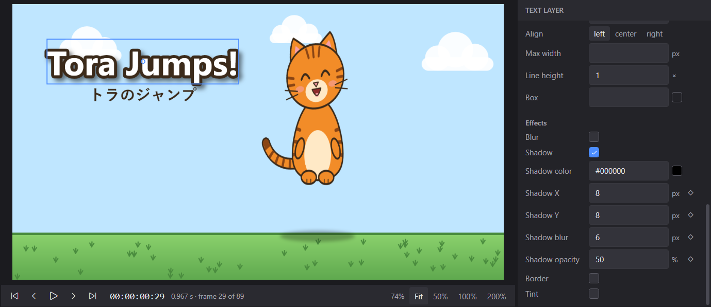
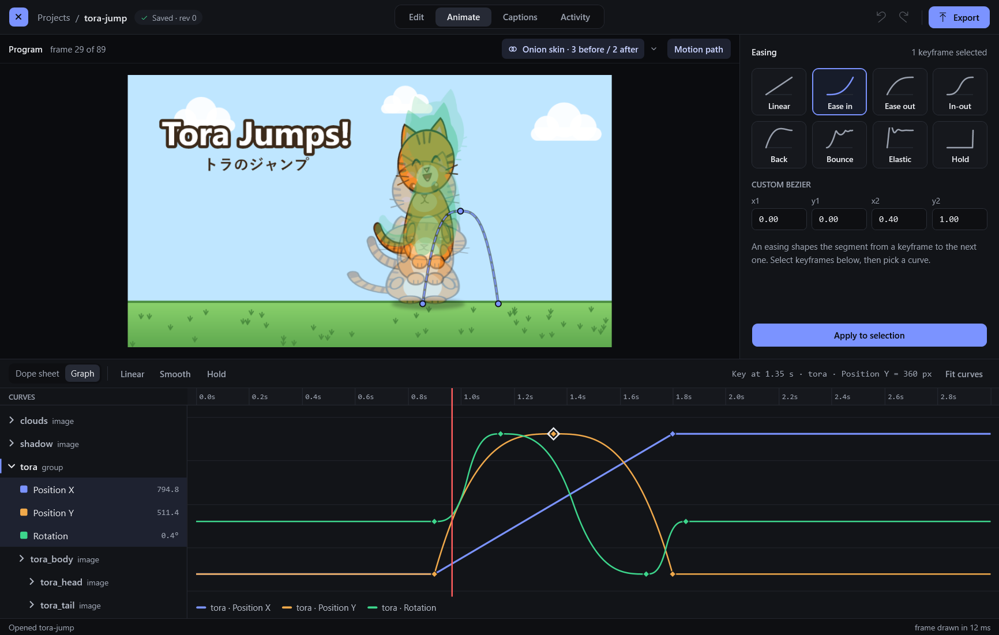
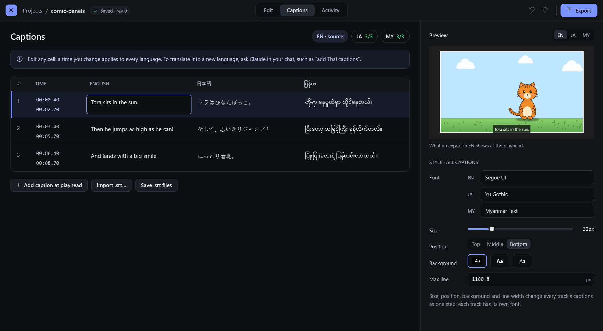

# The editor

`ZeyoCut.Editor.exe` opens a ZeyoCut project in a window, for fine-tuning by hand what the model made. It edits the same `project.json` as the server, at the same time: each change you make is saved at once and the model's next reply notes it, and what the model changes shows in the window within a second.

It imports media, plays the edit with its sound, moves, trims and splits clips on a timeline, places, crops and animates layers with keyframes, retimes and eases keyframes on a dope sheet or as curves, sets effects, color adjustments and face-blur settings, edits captions, changes volumes and a video's speed, and exports. Masks, motion paths and transitions stay with the model: ask it for those.

## Open a project

`ZeyoCut.Editor.exe` is in the release zip, next to `ZeyoCut.Mcp.exe`; [Install](install.md#the-editor-optional) says how it finds FFmpeg and your projects. Then:

- **Home**, the start page, shows your recent projects and then the rest of your projects folder. Each card has a picture of the project (its frame a second in, kept in the project's `cache\thumbnails` folder and drawn again once it's saved), its length, how many languages it's in, and "Claude edited 2 min ago" when Claude saved it last that day. The full folder is in its tooltip.
- The search box keeps the projects whose names have what you type, and the buttons on the right show them as cards or as a list. Show folder, at the bottom, opens the projects folder.
- Open folder… (Ctrl+O) opens any project folder, and so does dropping one on Home.
- **New project…** (Ctrl+N), or the Landscape, Shorts / Reels and Square cards under Start something new (each opens it with its canvas chosen), makes a project in the projects folder. It takes a name and a blank canvas (YouTube 1920×1080, HD 720p, Shorts 1080×1920, Square, Portrait 4:5 or any size typed in), a frame rate (24, 25, 30 or 60) and a background (black, white, sky blue or transparent). It can also start from a template in the library, which brings its own canvas, frame rate and background. The preview shows the canvas's shape with its safe area and says which export preset fits it. It makes the same `project.json` as `create_project` (or `new_project_from_template`) with those values, then opens it.
- From the command line: `ZeyoCut.Editor.exe C:\Users\you\ZeyoCut\projects\my-video`.
- Or ask the model to open the project in the editor ([`open_in_editor`](GUIDE.md#open_in_editor)).

A project is open in one window at a time: opening it again brings that window to the front.

A `project.json` with problems still opens, such as one edited by hand whose asset names a file outside `assets\`. The status bar names the problems and the media list marks those files; changes and exports are refused until they're fixed.

When a project opens with files missing (moved or renamed), the **Relink** view lists each one, where it was and how many clips use it. It looks for each in the project folder and the import folders, up to four folders down, for a file of the same name and kind with the same pixel size, the same length (within a frame) or the same font family, and offers what it finds. Search another folder… looks in a folder you pick, Choose file… takes any file of the same kind, and Leave it missing skips one. Relink and open copies the chosen files into `assets\` and points the assets at them, as `relink_asset` does, as one step Ctrl+Z undoes. Open without relinking leaves them missing; a missing tile's right-click menu has Relink… for later. Footage that needs normalizing (variable frame rate, rotation, HDR) is refused: import it instead and use the new asset.

The first time the editor starts, when it has no settings file yet, the **Welcome** view shows the projects folder and how to connect Claude: the `zeyocut` entry for Claude Desktop's `claude_desktop_config.json`, with the path of the `ZeyoCut.Mcp.exe` next to the editor, to copy, or the bundle to install instead. Its Connect step turns green when a client lists the server's tools after the Welcome opened (the server notes the last one in `connected.json` in its log folder). The last step copies the sample `examples\tora-jump` into the projects folder, unless a project of that name is there already, and opens it. Skip setup, or I'll do this later, goes to Home, and the Welcome doesn't open again.

The header across the top names the project and whether it's saved ("Saved · rev N"). The logo and **Projects** close the project and go back to Home. In the middle, **Edit**, **Animate**, **Captions** and **Activity** switch views; on the right are Undo and Redo, when Claude last saved the project, and **Export**, which opens the Export view (Ctrl+1, Ctrl+3, Ctrl+5, Ctrl+6 and Ctrl+E go to Edit, Animate, Captions, Activity and Export; ? or F1 lists every key). The status bar at the bottom names the selected clip, counts the layers and lanes, and says what the last change did.

## Media

The media panel shows a tile for each asset: a picture made small, a video's first frame, a sound's waveform and "Aa" for a font, with the length of footage and sound, and a dot in the kind's color. The name under a tile is the asset's id, which is what Claude calls it; the file name is in its tooltip, and a file that's gone is marked Missing in red. The chips All, Video, Images, Audio (and Fonts, when the project has one) show one kind. Thumbnails and waveforms are made in the background and kept in the project's `cache\thumbnails` and `cache\waveforms` folders; a file that changes gets new ones.

- Import, above the media list (Ctrl+I), imports images, audio, fonts and video. Video that needs normalizing (variable frame rate, rotation, HDR) is converted first, as `import_video` does, with its progress in the media list. Files you pick yourself can come from any folder; the import folders limit only what the model can read.
- Drag files from File Explorer onto the window to import them.
- Drag media from the list onto a lane of the timeline, or right-click it → Add at the playhead. A video or picture dropped on a picture lane is drawn at that lane's level, and anywhere else on a level of its own on top. Sound takes the role of the sound lane it's dropped on, else music.

## The preview

The preview draws the frame at the playhead with the same renderer as exports, from proxies for footage over 2560 px. Its header names the canvas ("16:9 · 1920×1080 · 30 fps"); the list on the right sets the zoom: Fit, 50%, 100% or 200%.

- The safe-area button draws the title-safe margin over the frame, and on a vertical canvas the strips the Shorts player covers, as `check_project` checks them. The grid button draws thirds. Both are drawn over the frame, never into it or the export, and the editor remembers them.
- F shows the frame on the whole screen; Esc or F leaves. Space plays there too, and ← and → step.

- Click a video, picture or text to select it: the one drawn on top there, a layer attached to a clip (a logo on a video, a part of a rig) too. Its box and anchor are outlined, and the timeline highlights the clip that holds it.
- Drag it to move it. The frame is redrawn as you drag, and the move is saved when you let go, as one undo step. Shift keeps it on one axis, and Escape puts it back. An animated position gets a keyframe at the playhead. A caption takes its whole track along. A layer on a motion path doesn't move: the path places it.
- When layers are tagged with languages, the preview draws one language's version, as an export in that language does: the list in its header (EN, JA) picks it, for the Captions view too, and the editor remembers it. English comes first, else the first language. The timeline shows every language's clips.
- A paused frame is drawn again within a second or so when a file it shows changes without a save, such as the matte of a background Claude removed with an AI method. Until it is computed, the preview draws the clip with its background, and exports refuse to start.

## Playback

Space plays and pauses, at 0.5×, 1× or 2×, with the sound mixed as the export mixes it. After an edit that changes the sound, the mix is made again in the background; until it's ready, playback is silent and says "updating sound…". While playing, frames are drawn at half size (Preview: Full, ½ or ¼ res, under the frame), and when drawing can't keep up, every second frame is shown. A paused frame is always full size. With Loop on, playing past the last frame goes on from the first.

Under the frame are the playhead's timecode and the last frame's. ← and → step a frame (with Shift, a second), and Home and End go to the first and last frame. The status bar shows the frame number.

## The timeline

There's a lane for each draw level (`zIndex`) of video, images and text, the highest on top; a lane for each caption track ("Captions · EN"); and Voice, Music and Sound effects lanes for sound. A draw level is named for what it holds (Video, Images, Text, or Mixed), and levels of the same name are numbered from the bottom: Video 2 draws over Video 1. The lane's tooltip gives its draw level. A layer with child layers (a logo attached to a clip, a rig) is one clip with a "+N" badge, and its children move, trim, split and delete with it.

Clips are drawn in their kind's color, a video's or picture's with its thumbnail at the start, and a sound's with its waveform from where it's trimmed. A hidden clip, or muted sound, is faded with a dashed edge and a crossed-out eye or speaker.

- Click a clip to select it and see it in the inspector.
- The eye beside a lane's name hides every clip in it, as one step to undo, and shows them all again once all are hidden. On a sound lane it's a speaker that mutes them.
- The Blade tool (B) splits a clip where you click it: a line shows where. Select (V, or Escape) goes back to moving and trimming.
- Add marker (M) puts a chapter marker at the playhead, as `add_markers` does, named Marker 1, Marker 2 and so on. Ask Claude to rename or remove markers.
- Drag a clip sideways to move it, or drag its edges to trim it; a video can show more as far as its source goes. Drag a video, picture or text clip up or down onto another lane to change what it's drawn over, or between two lanes to give it a level of its own. Escape cancels the drag.
- Held at the left or right edge of the lanes, a drag scrolls them, faster the further in, so a clip can go anywhere in a long video. Scrubbing in the ruler does the same.
- Clips snap to clip edges, the playhead and markers. The Snap button (N) turns it off.
- S (or Ctrl+B) splits the selected clip at the playhead, and Delete removes it with its child layers (a child layer selected in the preview is removed with its own children). Right-click a clip for these, for Hide and Show (Mute and Unmute for sound), and to turn a video's own sound off or on. Ctrl+D duplicates the selected clip with its child layers, as `duplicate_layer` does, and selects the copy.
- Click or drag in the ruler to move the playhead. ↑ and ↓ jump to the previous and next clip edge.
- The ruler and the lanes are shaded past the project's end: the export stops there, so what runs past it is cut. The project's Duration in the inspector moves the end.
- The selected clip shows its layer's keyframes as white diamonds along its bottom edge. Click one to move the playhead there; Alt+← and Alt+→ jump to the previous and next.
- Ctrl+wheel, −/+ or the zoom slider zooms, and Fit (Shift+Z) fits the whole video. The wheel scrolls the lanes, and Shift+wheel scrolls in time.
- **Pack lanes** puts layers that never show at the same time on shared levels, so clips the model added one at a time stop taking a lane each. Every frame looks as before. When it can't save a lane, the button is off.

## The inspector

The inspector shows the selected clip and changes it. With nothing selected, it shows the project: its Duration is changed there, as `update_project` changes it, and the rest is shown.

Its header names the clip with a badge for its kind, and says where it comes from and what goes with it ("from street.mp4 · 1 child · 2 redactions"). The ⋯ button has the timeline's right-click menu: split, delete, hide or mute, and a video's sound. The fields are on tabs by kind, and the tab you chose stays chosen for the next clip that has it:

| Clip | Tabs |
|---|---|
| Video | Video, Audio, Speed, Effects, Color |
| Picture | Image, Effects, Color |
| Text | Text, Style, Effects |
| Sound | Audio |
| Caption | Caption, Style |

- **Timing:** Start, End and Length, on one row, move and trim it.
- **Clip:** Draw level is its `zIndex`; Shown hides it (Muted for sound).
- **Attached:** a chip for each child layer (a logo on a video, the parts of a rig), which selects it, and for each cutout and redaction that follows the clip.
- **Speed:** a video's speed, as `set_speed` sets it: 2 plays it twice as fast in half the time. The clips after it stay where they are.
- **Sound:** a video has Sound on, and sound has its role, volume and fades.
- **Text:** a text's words and its style: font (an installed family, or a font file imported into the project), size, bold, color, outline, alignment, maximum width, line height and a box behind it. A caption's text is its own, and its style is the whole track's: a change applies to every caption in the track, as one undo step.
- **Transform:** Position X and Y place the layer's anchor on the canvas (a child layer's, in its parent's pixels), Scale W and H size it in percent (negative flips it), Rotation turns it in degrees around the anchor, and Opacity is in percent, by its slider or typed. The slider saves when you let it go, as one undo step. A layer that follows a motion path shows Position: the path places it; ask the model to change the path. A caption's X and Y move every caption in its track by the same amount.
- **Crop:** a video's Left, Top, Right and Bottom cut that many pixels of its file off each side. What's left of the picture stays where it was, and so do child layers on it. A crop the model animated is changed with keyframes; ask the model.
- **Effects:** Blur, Shadow, Border (the outline effect) and Tint switch an effect on and off, as `set_effect` does. Switched on, each shows its settings: the blur's size each way; the shadow's color, offset, softness and opacity; the border's color and width; the tint's color and amount (a new tint is white). Captions don't have them.
- **Color:** a video's or picture's Brightness, Contrast and Saturation, in percent: 0, 100 and 100 leave it as it is.
- **Face blur:** a video whose footage a redaction hides (`apply_redaction`) shows its settings: Style, Strength (pixelate and blur) or Fill color (solid), Padding, Feather and Hold frames, a section for each redaction. They are the redaction's, so they change every clip of that footage.

### Typing values

Enter saves a field, and so does clicking or tabbing away; Escape puts it back. In a text, Shift+Enter starts a new line.

While the keyboard is in a field, Ctrl+Z and Ctrl+Y undo and redo what you typed there. They don't reach the project's saved changes until you leave the field, also when nothing typed is left to take back.

Numbers take a point or a comma, with or without their unit: `2,5`, `2.5 s`, `40px`, `50%` and `15°` all work. A value the project can't take is refused with the reason, and the field shows what's saved.

### Keyframes

The diamond beside a number animates it. ◇ adds a keyframe at the playhead with the value shown; ◆ means there's one at the playhead, and takes it away. Blue means the value is animated. Taking away the last keyframe leaves the value it had there. Position and Scale have one diamond for both values: it keys both, or takes both keyframes away when both are there.

A value animated with keyframes shows its value at the playhead. Changing it adds a keyframe there (or changes the one on that frame), with the easing of the keyframe before it, so the move keeps its feel. That needs the playhead where the layer is. Clicking into an animated value or pressing its diamond while playing stops the playback first, so the change goes on the frame you see.

To blur seconds 2 to 4, say:

1. At 2 s, switch Blur on, set it to 0 and press ◇.
2. At 2.5 s, type 8.
3. At 3.5 s, press ◇.
4. At 4 s, type 0.

## Animate

**Animate** in the header (Ctrl+3) is for timing a move. The playback keys work here as in the Edit view.

- **The list on the left** has every layer with keyframes, under the layers it's attached to, and the camera when it moves; the selected layer is there even before it has any. ▸ opens a layer to its animated values, each with its value at the playhead (794.8, 120%, 5°), and an image layer's drawing changes (a head's `normal` and `happy`) are a value of their own. A layer's name selects it, as clicking its clip does.
- **Dope sheet** puts each value's keyframes on its row, and a layer's row has them all. Click a key to select it; Ctrl adds or takes one away, Shift adds, and clicking a value's name selects its keys. Drag keys to retime them: they move by whole frames and keep their values and easings, as one undo step. A key can't land on another's time. Clicking the ruler or an empty place moves the playhead.
- **Graph** draws the selected layer's values as curves, each fitted to the height, from the interpolation exports use; click a value in the list to add or take away its curve (up to six). Position Y and other values that grow down the frame are drawn the way the layer moves, so a jump goes up. Drag a key to change its time and its value; Shift keeps to one of the two. **Fit curves** fits the ruler to the curves' keys rather than the whole video.
- **Linear**, **Smooth** (ease in and out, F9) and **Hold** set the easing of the selected keys: how the value goes from each to the next key.
- **Easing** on the right has the eight easings as tiles, the selected keys' one marked; a tile sets it at once. **Custom bezier** takes a curve as CSS's `cubic-bezier()` does (x1 and x2 from 0 to 1, y1 and y2 past 0 or 1 to overshoot), and **Apply to selection** gives it to the selected keys, as `set_keyframes` does with easing `cubicBezier`.
- **Onion skin** draws the selected layer with the layers under it at the frames around the playhead: 3 before and 2 after, fainter the further they are, the ones after in green. The menu beside it sets how many, up to five each way, and Alt+O turns it off and on. It shows while paused and is never in an export.
- **Motion path** draws the selected layer's path across the frame: where its anchor goes, with a dot at each keyframe. Moving the path is the model's.
- **Alt+K** adds a keyframe at the playhead to the value clicked last in the list, or to the selected layer's position. **Delete** takes the selected keys away, and **Escape** clears them.

## Captions

**Captions** in the header (Ctrl+5) shows the caption tracks side by side. Each row is a caption of the source track (English when there is one) with the other languages' captions that go with it: the ones it overlaps most. A caption that goes with none of the source's has a row of its own. The chips at the top name the tracks and how many rows each fills ("JA 3/3"); without an English track, a chip makes its track the source.

- A cell saves its caption's text on Enter or when you leave it; Shift+Enter starts a new line, and Escape puts it back. Emptying a cell removes its caption, and typing into an empty one adds a caption to that track at the row's times, styled like the track's others.
- A row's start and end (`00:03.40`, or seconds) move its captions in every language, as one undo step. Going into a row takes the playhead there, and the row the playhead is in is marked.
- **Add caption at playhead** adds a row at the playhead, or after the caption the playhead is in, up to the next caption: type a caption into it in any language. Escape in the empty row takes it away.
- **Import .srt…** reads a subtitle file as `import_srt` does. Choose its language (the file name's, as in `talk.ja.srt`, comes filled in), and it becomes that language's track, in place of the one there.
- **Save .srt files** writes each track to the `exports` folder as `export_srt` does, named as the Export view names them (`comic-panels.en.srt`); Show in folder opens it.
- **Preview** shows the frame at the playhead in one language's version, the one the Edit view shows too.
- **Style · all captions:** each track's font, and the size, the position (Top, Middle or Bottom, inside the title-safe margin), the background (a box, an outline or none) and the longest line, in pixels, of every track's captions, each change as one undo step.
- A new language is the model's: ask Claude in your chat, such as "add Thai captions" (`add_caption_track`).

## Export

Export in the header (Ctrl+E) opens the Export view, and Back to edit returns to the timeline. It renders the project as it's saved to an MP4 in its `exports` folder, as the model's `start_export` does, in the editor's own process. Edits made while it runs aren't in it.

- **File name**, and **Save to**: the project's `exports` folder, which Show folder opens. Exports always go there.
- **Preset** cards: the project's settings or a preset, each with the size and frame rate it exports at (a preset keeps the project's frame rate). A preset of another shape than the canvas says what it needs ("Needs a 9:16 project"); ask Claude to change the canvas first.
- **Language version**, when layers are tagged with languages: every layer, or one language's version. **Also save .srt files** saves each caption track you tick next to the video once the export is done, as `export_srt` writes it: `talk.mp4`'s English captions in `talk.en.srt`, captions without a language in `talk.srt`.
- **Quality**: High (`start_export`'s crf 18, the default), Balanced (23) or Small (28), a smaller file with a softer picture. The format is always MP4 with H.264 video.
- The card on the right shows a picture of the project, the resolution, frame rate, duration and captions the export will have, and **Export**.

Under **Exports folder**, an export running here has its progress and Stop; exports Claude runs on this project (from the server's job records) show their progress and can't be stopped here. Each file in the folder has Play, which opens it in the default video player, and Show in folder. Replacing a file asks first, and closing the window or the project while an export runs asks whether to stop it.

## Working with the model

- **Every change is saved at once**, as one step that Ctrl+Z undoes and Ctrl+Y redoes. The header shows "Saved · rev N" and the status bar what the last change did; there's no Save button. The header says "Saving…" while a change is being saved: when the server is saving at that moment, your change is saved after it (it waits up to 5 s), and the window goes on working meanwhile. Split, Delete, Pack lanes, a keyframe diamond and Export, pressed meanwhile, wait for it and then act on the project as saved, and closing the window hides it at once and lets the change finish saving before it closes.
- When a change can't be saved, because another program holds `project.json` or its folder is read-only or gone, the change isn't made and the status bar says why. Make it again once the file can be written.
- If the editor runs into an error it didn't expect, it says so in plain words and goes on; your changes before it are saved. The details are added to `editor-errors.log` in the log folder (`%LOCALAPPDATA%\ZeyoCut\logs` by default): include them when you report the problem.
- When the server saves the project, the editor shows the new version and says what changed. The server's next reply lists what the editor changed. Undo on either side takes back only its own changes. See [Saving alongside another program](project-format.md#saving-alongside-another-program).
- Ctrl+Z can't take back your change to a layer the server changed after it: that would throw the server's change away, and the status bar says so. The next Ctrl+Z steps over that change, which stays as it is, undoes the one before it and names the one it stepped over. Ctrl+Y does the same with a change it can't put back.
- A change you began before the server's isn't saved over it. If the server changes a layer while you're typing in one of its fields or dragging it, your change isn't saved and the status bar says "Your change wasn't saved: another program changed '…' first". What you typed stays in the field: Enter saves it over the server's change, Escape drops it.
- The header says when Claude last saved the project ("Claude saved 3 min ago"); hover over it for what it changed.
- The **Activity** view (Ctrl+6) lists the saves the `backups` folder keeps, yours and Claude's, newest first under their days. Saves in a row by the same side, each under 5 minutes after the one before, are one step, named after its first edit ("trim_layer title, then 2 more"), with when it was made, the revision it saved and its edits; a restore is a step of its own. **All**, **You** and **Claude** choose whose steps show.
- **Restore** on a step saves the project as that step left it as the next revision, the way `restore_backup` does, and Ctrl+Z takes it back; the server's next reply names it. The newest step is the project as it is, so it has no Restore, and neither has a step whose next save isn't kept ("Saves in between aren't kept"). If the server saved a change you haven't seen yet, nothing is restored and you see its version first.
- A card beside the steps suggests things to ask Claude in your chat: the editor has no AI built in.

## Keys

? or F1, outside a text field, opens **Keyboard shortcuts**: these keys in their groups, with a search box that finds an action by its name or its keys ("snap", "ctrl d"). The list and the keys come from one table, so they can't disagree.

| Key | What it does |
|---|---|
| Space | Play and pause |
| F | The frame on the whole screen; Esc or F leaves |
| ← / → | The previous and next frame; with Shift, a second |
| Home / End | The first and last frame |
| ↑ / ↓ | The previous and next clip edge |
| Alt+← / Alt+→ | The selected clip's previous and next keyframe; in Animate, of the selected layer and the layers under it, or of every layer listed when none is selected |
| Alt+K | In Animate, a keyframe at the playhead for the value clicked last, or the selected layer's position |
| F9 | In Animate, ease the selected keys in and out (Smooth) |
| Alt+O | In Animate, the onion skin on and off |
| S or Ctrl+B | Split the selected clip at the playhead |
| B / V | The Blade tool, which splits a clip where it's clicked, and the Select tool |
| M | Add a chapter marker at the playhead |
| Delete or Backspace | Delete the selected clip with its child layers; in Animate, the selected keys |
| Ctrl+D | Duplicate the selected clip with its child layers |
| Escape | Close the view open over the window, else cancel a drag, else go back to the Select tool, else clear the selection; in a field, put it back |
| − / + | Zoom the timeline out and in (also Ctrl+wheel) |
| Shift+Z | Fit the whole video in the timeline |
| N | Snapping on and off |
| Ctrl+Z / Ctrl+Shift+Z or Ctrl+Y | Undo and redo; in a field, the typing there |
| Ctrl+1 / Ctrl+3 / Ctrl+5 / Ctrl+6 / Ctrl+E | Edit, Animate, Captions, Activity and Export |
| Ctrl+N | New project |
| Ctrl+O | Open a project |
| Ctrl+I | Import media |
| ? or F1 | Keyboard shortcuts |

## Settings

The editor reads `FfmpegPath`, `ProjectsRoot`, `LibraryPath` and `VideoEncoder` from the same `appsettings.json` and environment variables as the server (see [Configuration](https://github.com/zeyarwinthu/zeyocut#configuration)). It keeps its own settings (recent projects, cards or list on Home, panel sizes, window position, snapping, playback size, preview language, the onion skin's frames and whether it and the motion path show) in `%LOCALAPPDATA%\ZeyoCut\editor.json`, or the file `ZEYOCUT_EDITOR_SETTINGS` names, never in the project. While there's no such file, the editor starts with the Welcome view.

## What it leaves to the model

- Masks, motion paths and transitions. The Animate view draws a motion path but doesn't move it.
- Saving a custom easing as a preset, and a curve's bezier handles in the graph: type the curve's numbers instead.
- Closing a gap: deleting a clip leaves one. The model's `remove_range` cuts a stretch of time out of every layer.
- One clip is selected at a time.
