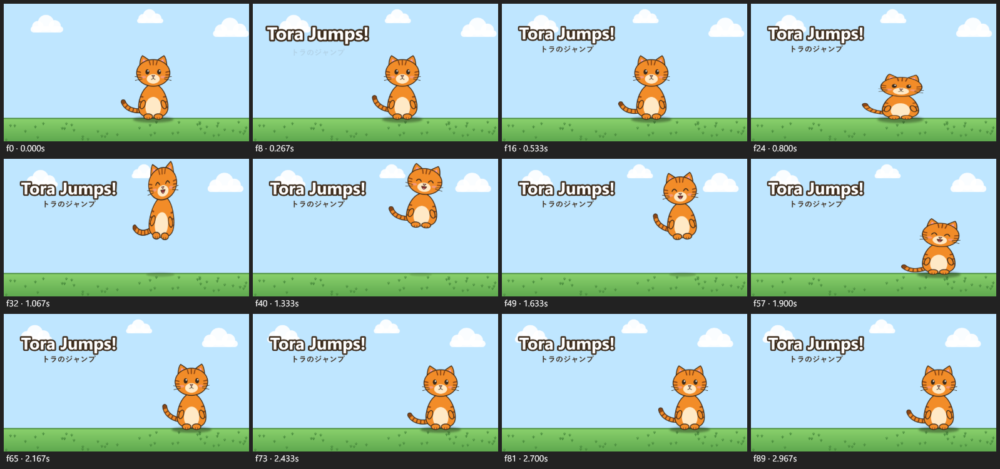

# Examples

Three small projects in the repository's [`examples`](https://github.com/zeyarwinthu/zeyocut/tree/main/examples) folder, made with ZeyoCut's own tools from art and sounds that ZeyoCut draws and generates itself. For a video of your own, the [talking-head cleanup](#talking-head-cleanup) steps cut the pauses, add captions and export it.

| Project | What it shows |
|---|---|
| [`tora-jump`](https://github.com/zeyarwinthu/zeyocut/tree/main/examples/tora-jump) | A cutout character rig: squash and stretch, easing, a drawing swap, a lagging head and a wagging tail, sound effects, and a Japanese subtitle |
| [`tora-and-mimi`](https://github.com/zeyarwinthu/zeyocut/tree/main/examples/tora-and-mimi) | A rig and an action from the library: two copies of one character, each playing the same jump at its own time and speed, with a title in English, Japanese and Burmese versions |
| [`comic-panels`](https://github.com/zeyarwinthu/zeyocut/tree/main/examples/comic-panels) | A comic-panel video: panels with zooms and a pan, a crossfade and a slide, sound effects, and caption tracks in three languages |



## Open one

Download the repository (or its [zip](https://github.com/zeyarwinthu/zeyocut/archive/refs/heads/main.zip)) and copy an example into your projects folder:

```powershell
New-Item -ItemType Directory -Force "$env:USERPROFILE\ZeyoCut\projects" | Out-Null
Copy-Item -Recurse examples\tora-jump "$env:USERPROFILE\ZeyoCut\projects\"
```

Then ask:

> Open the ZeyoCut project tora-jump and show me a contact sheet.

## The prompts

Each example could come from a prompt like these. The [examples README](https://github.com/zeyarwinthu/zeyocut/blob/main/examples/README.md) also lists the tool calls that built each one.

**tora-jump**

> Create a ZeyoCut project "tora-jump", 1280x720, 3 seconds, sky blue. Make a cat from body.png, head.png, head_happy.png and tail.png: the head parented at the neck with a normal and a happy drawing, the tail at the back. Make it jump with squash before takeoff, stretch in the air and an easeOutBack landing; the head lags behind the body, the face turns happy in the air, and the tail wags. Add a boing at takeoff, a thud at landing, and the title "Tora Jumps!" over the subtitle "トラのジャンプ". Show me a contact sheet with debug on.

**tora-and-mimi**

> Open tora-jump. Save Tora as a rig called tora, and the jump from 0.5 to 2.4 seconds as an action called jump. Then make a 4-second project "tora-and-mimi" with the same sky, clouds and ground. Put Tora on the left and a gray copy, Mimi, on the right. Tora jumps at 0.2 seconds and Mimi at 1.3 seconds, a little faster. Add the title "Hello!" in English, "こんにちは！" in Japanese and "မင်္ဂလာပါ" in Burmese, and show me each version at 1.6 seconds.

**comic-panels**

> Make a 9-second comic video from panel1.png, panel2.png and panel3.png, 3 seconds each, on a dark background. Zoom slowly into the first, pan across the second and zoom out of the last. Crossfade into the second panel and slide into the third. Add a boing when Tora jumps and a thud when he lands, and captions in English, Japanese and Burmese, each as its own track.

## Talking-head cleanup

This one has no project folder: it needs a video of someone talking, and the repository keeps video files out. Use a clip of your own. Put it in your Videos folder (or another [import folder](install.md#folders)) and pick ZeyoCut's `talking_head_cleanup` prompt with the video's path. In Claude Code, that's a slash command:

```text
/mcp__zeyocut__talking_head_cleanup C:\Users\you\Videos\talk.mp4
```

Other clients that support MCP prompts show it in their own way, often in a menu. Or ask in your own words:

> Clean up Videos\talk.mp4: cut the pauses with punch-in zooms, add captions, check the loudness, and export it for YouTube and as a Short.

The prompt takes the model through these steps:

1. `create_project` with the `youtube_1080p` preset, then `import_video` and `add_video_layer`.
2. `analyze_video` finds the silences and, with [whisper](install.md#transcripts-optional), transcribes the words. Without whisper there are no captions.
3. `remove_silences` as a dry run. **The model stops here** and tells you how many pauses it would cut and how much shorter the video gets; go ahead, or keep more of the pauses.
4. `remove_silences` with `punchIn`: every second piece is zoomed in a little, which hides the jump cuts. Filler words can go too, with `cut_by_transcript`.
5. `generate_captions`, then `render_contact_sheet` to look at the cuts, the punch-ins and the captions.
6. `audio_levels` checks the loudness (exports are normalized to -14 LUFS), and `check_project` and `frame_diff` look for mistakes.
7. `export_batch` with `youtube_1080p` and `shorts_1080p`: a 16:9 video, and a 9:16 one with the whole picture over a blurred copy of itself.

For a Short cropped to the speaker instead, ask for one: `reframe_to_vertical` keeps the speaker in the frame. The [guide](GUIDE.md#workflow-prompts) shows the whole prompt.
