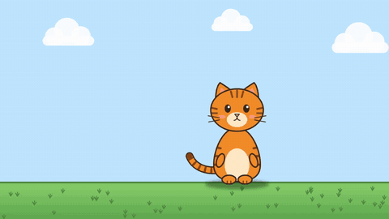
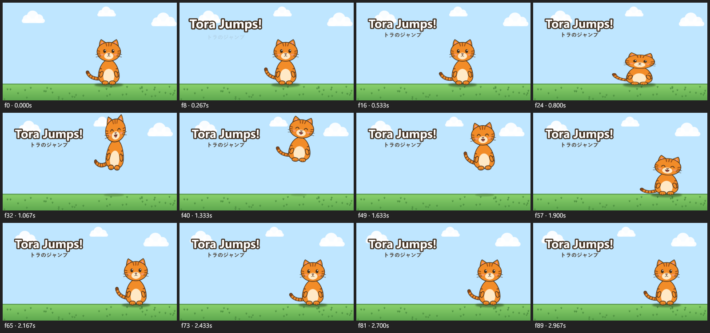

# ZeyoCut

**A video and animation editor that an AI model drives.** ZeyoCut has no window of its own: it is an [MCP](https://modelcontextprotocol.io) server for Windows. You tell Claude, or another MCP client, what you want. The model builds the project through ZeyoCut's tools, looks at rendered frames to check its work, and exports the MP4.

[Download for Windows](https://github.com/zeyarwinthu/zeyocut/releases/latest){ .md-button .md-button--primary } [Get started](quick-start.md){ .md-button } [See the examples](examples.md){ .md-button }

ZeyoCut is free and open source under the MIT License, and runs entirely on your computer.

## What it does

- **Cutout animation with rigs and actions.** Characters made of PNG parts in a parent–child hierarchy, with keyframes and easing (overshoot, bounce, elastic), squash and stretch, drawing swaps such as a face changing expression, and motion along curved paths. Save a character as a rig and a walk cycle or a jump as an action: the action plays on any copy of the rig, at any speed.
- **Comic-panel videos.** Pan and zoom over still images, timed to a voiceover, with music and subtitles.
- **Footage editing.** Analysis finds scene cuts, silences and a transcript with a time for every word. Cut silences and filler words, join clips with transitions, burn in captions or export SRT, duck music under voice, normalize loudness, and export for YouTube and as a vertical Short from one call.
- **Burmese, Japanese and other languages.** Text is shaped with HarfBuzz, so Burmese stacking and Japanese line breaking come out right. One project can hold a version per language, each with its own titles, voice and captions, and one call exports them all.
- **Privacy blur.** An AI model on your computer finds every face or license plate in a clip. Each one is tracked and hidden with a fail-safe that leaves no frame uncovered, and a report lists the spans to check before you export. Nobody is recognized and no plate is read.
- **Cutouts and tracking.** Backgrounds come off green-screen footage, generated art and ordinary footage of people, titles go behind the person, and a name or a sticker can follow a face.
- **Checks and hand-off.** Checks before export find glitches, loudness problems and project mistakes. The timeline exports as OpenTimelineIO or FCPXML for DaVinci Resolve or Final Cut Pro.

## How it works

1. You ask for a video in your MCP client, in your own words.
2. The model creates a project and calls ZeyoCut's tools to import your files, place layers, animate them, cut footage and add captions. Each change is checked, saved and can be undone.
3. The model looks at rendered frames, like this contact sheet, to see what it made, and fixes what's wrong:

    

4. It exports the video with FFmpeg. A preview page in your browser plays the edit with its sound along the way.

Previews and exports go through the same renderer, so the frame the model checks is exactly the frame that gets encoded.

## Private by design

ZeyoCut has no telemetry and no account, and your projects and media stay on your computer. The only thing it downloads is an AI model, from its original source, the first time a feature needs it. See [Privacy](privacy.md).
